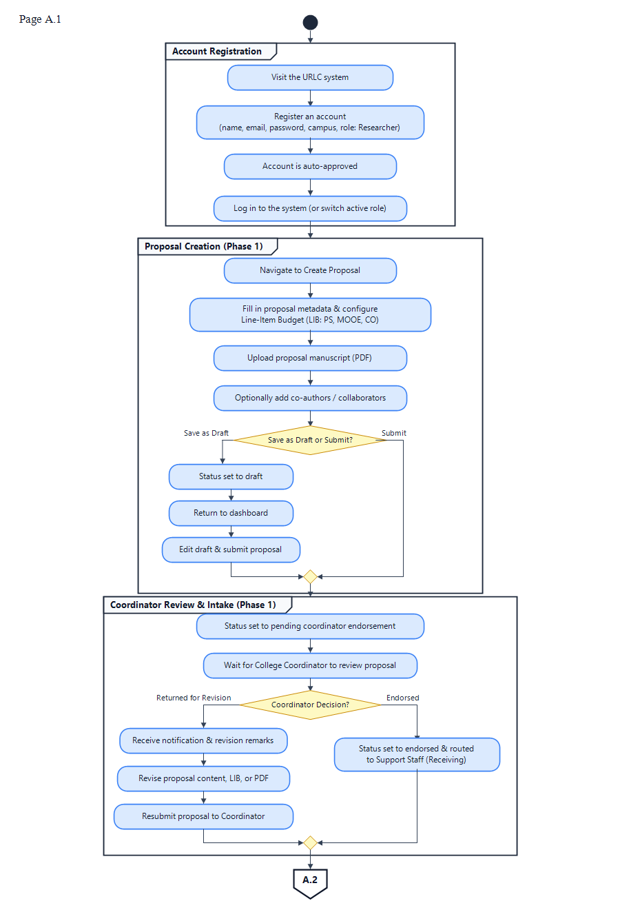

# CHAPTER IV
# RESULTS AND DISCUSSION

## 4.1 Brief Introduction

This chapter presents the empirical results of the development, functional testing, and software quality evaluation of the **University Research Lifecycle – Digital Platform (URLC System)**. Designed and implemented for the University of Antique Research Unit, the URLC System replaces fragmented, manual, and semi-digital paper routing with a centralized, cloud-hosted web application. The platform incorporates nine specialized institutional role portals, automates the five-phase university research lifecycle from pre-award submission to repository archiving, integrates an Institutional Budget Allocation Matrix across four fund types, and provides server-side automated generation of official administrative instruments including the Notice of Acceptance (NOA), Notice to Proceed (NTP), and Certificate of Research Completion.

The findings presented in this chapter report what was actually accomplished, verified, and measured during the development and evaluation phases. The results are structured directly in relation to the specific project objectives established in Chapter I. The chapter details the completed system modules with corresponding operational screenshots, documents the execution of functional test cases alongside calculated pass rates, presents the statistical analysis of the software quality evaluation conducted with thirty (30) end-users based on the ISO/IEC 25010 standard and five (5) IT experts using McCall’s Software Quality Model, and synthesizes the overall findings through a formal Objective Attainment Summary.

---

## 4.2 Results Based on the Project Objectives and Actual System Development

To establish clear evidence of project completion, the actual deliverables and operational capabilities of the URLC System were evaluated against the specific objectives defined in Chapter I. Each subsection below restates the objective, discusses the completed modules, presents the operational interface with its corresponding figure caption, analyzes the observed system behavior, and concludes with an objective-attainment determination.

### 4.2.1 Objective 1: Implementation of Role-Based Access Control (RBAC) and Specialized User Dashboards

> **Objective 1:** *Implement a robust Role-Based Access Control (RBAC) system to provide distinct dashboards and access levels tailored to Researchers, College Coordinators, College Deans, Reviewers/Evaluators, Budget Officers, Administrators (Research Director), and the VPREI for institutional governance.*

To achieve Objective 1, the researchers engineered a comprehensive Role-Based Access Control (RBAC) framework within the Laravel 8 application tier, enforced via custom middleware (`RoleMiddleware`, `ApprovalMiddleware`, and `PreventBackHistory`). Passwords were encrypted using Bcrypt hashing, and session guards strictly restricted route access based on authenticated user roles. The system accommodates nine specialized institutional roles alongside a pre-seeded Super Admin, delivering dedicated dashboards tailored to each stakeholder's administrative scope.

#### A. User Registration and Authentication Module
The authentication module provides secure entry into the URLC platform. New faculty members register with their institutional email, campus, and college affiliation, with Researcher accounts being automatically approved upon registration. Conversely, administrative and evaluator roles (Coordinators, Deans, Reviewers, Staff, Budget Officers, VPREI) enter an approval queue requiring verification by the Super Admin prior to account activation.

*(Refer to Manuscript Figure 31: User Register/Login Form)*

**Figure 31. User Register and Login Form**

Figure 31 illustrates the unified authentication portal of the URLC platform. The interface incorporates client-side input validation and CSRF token protection. Upon entering valid credentials, the system authenticates the user, retrieves their assigned primary and secondary roles from the PostgreSQL database, and dynamically routes the session to the designated dashboard. If unauthorized access is attempted, the system displays descriptive error prompts without exposing backend system parameters.

#### B. Faculty Researcher Dashboard
The Faculty Researcher Dashboard serves as the centralized workspace for university faculty members conducting research. It provides real-time visibility into active proposals, revision requests, and project milestones.

**Figure 32. Researcher's Dashboard**

Figure 32 shows the primary workspace of an authenticated faculty researcher. The dashboard features KPI summary cards displaying the counts of Total Submissions, Proposals Under Review, Revisions Needed, and Approved Researches. Below the metrics, an actionable data table displays active proposal codes, titles, lifecycle phases, and current statuses, allowing researchers to track progress from Phase 1 through Phase 5 without requiring manual inquiries at the Research Unit office.

#### C. College Coordinator Dashboard
The College Coordinator Dashboard functions as the initial departmental quality-control checkpoint, filtering submissions exclusively from the coordinator's assigned academic college.

**Figure 40. Coordinator's Dashboard**

Figure 40 depicts the College Coordinator interface. The dashboard features an "Endorsement Center" that isolates incoming proposals awaiting college review. Coordinators can inspect proposal metadata, examine attached Line-Item Budgets (LIB), and download PDF manuscripts. The interface provides action buttons enabling the coordinator to formally endorse the submission or return it to the researcher with specific corrective remarks.

#### D. College Dean Dashboard
The College Dean Dashboard provides executive oversight at the collegiate level, enabling deans to monitor college-wide research productivity and execute formal endorsements.

**Figure 46. Dean's Dashboard**

Figure 46 illustrates the College Dean Dashboard. The interface aggregates college-level metrics and presents a filtered queue of proposals requiring either Phase 1 Initial Endorsement Noting or Phase 3 Post-Evaluation Final Copy Noting. Deans can inspect technical reviewer rubric clearances and verified revisions before transmitting official concurrence to the Budget Office.

#### E. Support Staff (Receiving) Dashboard
The Support Staff (Receiving) Dashboard facilitates centralized intake verification at the University Research Unit.

**Figure 50. Support Staff (Receiving) Dashboard**

Figure 50 shows the intake management interface utilized by receiving staff. The dashboard displays coordinator-endorsed proposals awaiting documentary completeness checks. Staff members examine compliance checklists (e.g., ethics clearance, college endorsements, formatting compliance) and execute "Receive & Forward," logging the receipt timestamp and advancing the dossier to the Research Director's evaluation queue.

#### F. Technical Reviewer Dashboard
The Technical Reviewer Dashboard supports academic peer review and ethics evaluation.

**Figure 56. Reviewer's Dashboard and Review Feedbacking**

Figure 56 depicts the assigned evaluations portal for technical reviewers. The interface lists proposals assigned by the Research Director. Reviewers can securely download manuscripts via time-signed S3 links, access the interactive Evaluation Rubric, input quantitative criterion scores, and formulate structured qualitative feedback (comments and suggestions) for researcher compliance.

#### G. Support Staff (Recording) Dashboard & Institutional Budget Matrix
The Recording Staff Dashboard provides end-to-end monitoring of active proposals, manages completed research archives, and administers the institutional budget matrix.

**Figure 62. Support Staff (Recording) Dashboard**

Figure 62 illustrates the Routing Tracker (Proposal Flow Monitor), allowing recording staff to track the real-time location and phase status of every proposal across the university. Figure 63 further displays the two-tier **Institutional Budget Allocation Matrix**, allowing staff to allocate and monitor research funding across the four fund categories (*GAA*, *Local Trust Fund*, *Foreign Trust Fund*, and *Implementation Trust Fund*) across Main Campus program units and the four satellite campuses (*Libertad*, *Caluya*, *Hamtic*, and *Tibiao*), complete with print-ready summary generation.

#### H. Budget Officer Dashboard
The Budget Officer Dashboard serves as the financial gatekeeper of the research lifecycle.

**Figure 68. Budget Officer Dashboard**

Figure 68 displays the financial verification interface. The Budget Officer inspects itemized Line-Item Budgets (LIB) across Personnel Services (PS), Maintenance and Other Operating Expenses (MOOE), and Capital Outlay (CO). The officer verifies fund source availability and executes "Certify Fund Availability," recording a digital financial seal (`funds_certified`) required prior to executive sign-off.

#### I. Research Director (Admin) Dashboard
The Research Director Dashboard centralizes operational governance across all research phases.

**Figure 67. Research Director Dashboard**

Figure 67 presents the administrative control center. The Research Director monitors global KPI metrics, approves incoming staff registrations, assigns qualified technical reviewers to proposals, oversees revision cycles, executes formal director endorsements to the VPREI, and authorizes Certificate of Research Completion issuance.

#### J. VPREI Executive Dashboard
The Vice President for Research, Extension, and Innovation (VPREI) Dashboard provides high-level executive intelligence and final award authorization.

**Figure 74. VPREI Dashboard**

Figure 74 depicts the executive approval portal. The VPREI reviews director-cleared dossiers with complete audit histories (evaluator rubric scores, Dean endorsements, and Budget Officer certifications). Upon clicking "Grant Final Executive Approval," the platform updates the proposal status and automatically triggers the DomPDF engine to render official, publication-styled Notice of Acceptance (NOA) and Notice to Proceed (NTP) documents.

> **Objective Attainment Statement:** Objective 1 was **Attained**. The URLC platform successfully developed and deployed nine distinct, role-governed dashboards and an administrative control portal. Role-scoped middleware strictly enforced access boundaries, verified permissions, and delivered specialized operational queues tailored to each stakeholder.

---

### 4.2.2 Objective 2: Development of the Sequential Proposal Monitoring Pipeline Across All Five Lifecycle Stages

> **Objective 2:** *Develop a sequential proposal monitoring pipeline that systematically guides and tracks research progress through all stages, beginning with initial manuscripts submission, transitioning through evaluation, and ending at research completion.*

The researchers successfully engineered an end-to-end proposal monitoring pipeline dividing the research lifecycle into five sequential, auditable phases. Each phase requires mandatory gating clearances before advancing, preventing procedural omissions.

#### A. Phase 1: Proposal Submission and Intake Checkpoint
In Phase 1, faculty researchers encode proposal metadata, itemize dynamic Line-Item Budgets, and upload the initial manuscript PDF.

**Figure 34. Researcher Submission Module**

Figure 34 shows the proposal intake form. The system validates required fields (title, abstract, research agenda alignment, funding source, timeline) and provides a drag-and-drop file upload zone. Upon submission, the proposal is assigned a unique tracking code (e.g., `RP-2026-002`) and routed to the College Coordinator and Support Staff (Receiving) for compliance checking.

#### B. Phase 2: Technical and Ethics Evaluation Pipeline
In Phase 2, the Research Director assigns peer reviewers who evaluate the manuscript using standardized evaluation rubrics.

**Figure 61. Reviewer Evaluation and Rubric Interface**

Figure 61 illustrates the reviewer scoring workspace. Reviewers evaluate submissions against institutional criteria and select binding decisions: *Approve*, *Approve with Revisions*, *Request Revision*, or *Reject*. If revisions are required, the proposal loops back to the researcher's workspace with side-by-side critique points. Once revised drafts are verified, the proposal clears Phase 2.

#### C. Phase 3: Dean Noting and Budget Availability Certification
In Phase 3, the final revised manuscript is officially noted by the College Dean and audited by the Budget Officer.

**Figure 47. Dean's Proposal Review and Noting Interface**

Figure 47 shows the Dean's review view. The Dean notes the revised manuscript, advancing it to the Budget Officer. The Budget Officer audits line items against institutional fund caps (GAA, Local Trust, Foreign Trust, Implementation Trust) and certifies fiscal availability, transitioning the status to `funds_certified`.

#### D. Phase 4: Executive Endorsement and Award Issuance
In Phase 4, the Research Director reviews the complete dossier and endorses it to the VPREI for final executive decision.

**Figure 81. Admin View Proposal Details & Endorsement Module**

Figure 81 demonstrates the administrative dossier inspection screen. Following director endorsement, the VPREI grants final executive approval, unlocking project commencement and triggering automatic legal notice generation.

#### E. Phase 5: Implementation Monitoring and Repository Archiving
In Phase 5, researchers track project implementation by submitting milestone progress reports, Activity Designs, and Purchase Requests (PR).

**Figure 37. Centralized Research Document Repository**

Figure 37 shows the institutional repository. Upon project conclusion, researchers submit the Terminal Report and final manuscript. Once validated by recording staff, the study is archived in the searchable repository, allowing university stakeholders to browse, filter, and access authorized research outputs.

> **Objective Attainment Statement:** Objective 2 was **Attained**. The sequential proposal monitoring pipeline successfully guided research projects through all five institutional phases. State transitions were strictly enforced, providing continuous tracking from initial submission to final repository archiving.

---

### 4.2.3 Objective 3: Automation of Proposal Workflow and Status Management

> **Objective 3:** *Automate proposal workflow and status management to dynamically update and manage proposal states (Pending, Accepted for In-house Review, Revision Required, Final Copy Noted, Funds Certified, Endorsed to VPREI, Approved, and Completed) as they clear institutional checkpoints.*

The URLC platform implements an event-driven workflow engine that automatically transitions proposal states across fourteen distinct lifecycle status flags: `submitted`, `endorsed`, `received`, `under_review`, `revision_required`, `approved_by_reviewers`, `final_copy_noted`, `funds_certified`, `endorsed_to_vprei`, `final_approved`, `ongoing`, `completed`, `archived`, and `rejected`.

**Figure 35. Researcher Proposal Details and Status Timeline**

Figure 35 displays the interactive proposal details workspace. An interactive multi-step visual timeline renders at the top of the interface, dynamically highlighting the proposal's current lifecycle stage (e.g., *Phase 1: Submission & Peer Review*, *Phase 2: In-House Review*, *Phase 3: Dean & Budget Certification*, *Phase 4: Executive Approval*, *Phase 5: Implementation*). Status badges update immediately upon action execution without full page refreshes, powered by Alpine.js.

Furthermore, every status transition triggers asynchronous background email notifications via Laravel Queue Jobs and Gmail SMTP. Researchers, evaluators, and administrators receive immediate email alerts when actions are required (e.g., revision requested, fund availability certified, executive approval granted), eliminating communication bottlenecks.

> **Objective Attainment Statement:** Objective 3 was **Attained**. The platform successfully automated proposal workflow transitions across all designated institutional states. Visual timeline trackers and automated email alerts provided real-time status updates across all user roles.

---

### 4.2.4 Objective 4: Deployment of the Interactive Announcement Module

> **Objective 4:** *Deploy an announcement module allowing administrators to publish Call for Papers, In-house Review schedules, and Inception schedules, equipped with interactive features (likes and comments) to foster engagement across the research community.*

To enhance academic community engagement, the platform incorporates an Announcement and Bulletin Module accessible across all nine user dashboards.

**Figure 36. Institutional Announcement and Call for Papers Module**

Figure 36 illustrates the Announcement feed. Authorized administrators and the Research Director can compose and publish institutional updates—such as Call for Papers announcements, Annual SUC In-House Review schedules, and Inception Review dates—complete with banner images and deadline dates. 

The module features dynamic community engagement tools:
* **Interactive Likes:** Authenticated users can like announcements, with live count increments.
* **Threaded Commenting:** Faculty members and coordinators can post inquiries and remarks directly beneath announcements, fostering transparent discussions regarding guidelines and deadlines.
* **Role-Scoped Management:** Administrators retain full control to edit or delete announcements, while Spatie audit logs track publishing activities.

> **Objective Attainment Statement:** Objective 4 was **Attained**. The announcement module was successfully deployed with interactive liking, commenting, and bulletin management capabilities, effectively supporting university-wide research communication.

---

### 4.2.5 Objective 5: Streamlining Document Processing and Automated Legal Notice Generation

> **Objective 5:** *Streamline document processing and administrative outputs to support secure PDF uploads, manuscript histories, and the automated generation of system forms (Notice of Acceptance, Notice to Proceed, and Certificate of Completion).*

The URLC platform streamlines document operations by combining cloud object storage with server-side document rendering.

#### A. Secure Cloud Storage and Manuscript Versioning
Research manuscripts and supporting documents are decoupled from the host web server and stored in private Supabase S3-compatible cloud storage buckets using the Flysystem S3 driver. All document downloads are secured through time-signed, temporary expiring URLs, preventing unauthorized public access. When reviewers request changes, researchers upload new versions through the `ProposalRevision` pipeline, maintaining a complete, auditable manuscript version history.

#### B. Automated DomPDF Legal Document Engine
Upon executive approval, the platform automatically compiles institutional Blade templates into standardized, publication-grade PDF documents using Laravel DomPDF.

**Figure 81-B. Automated Generation of Official Notice to Proceed (NTP)**

*(Demonstrating server-side PDF output with institutional seal, dynamic metadata, approved Line-Item Budget totals, and authorized administrative digital signatures).*

The system dynamically renders three primary legal instruments:
1. **Notice of Acceptance (NOA):** Issued upon VPREI approval confirming institutional acceptance of the proposal.
2. **Notice to Proceed (NTP):** Authorizes project commencement, citing the approved budget allocation, project duration, and terms of reference.
3. **Certificate of Research Completion:** Issued upon satisfactory verification of the Terminal Report and completion deliverables.

These documents are streamed directly to the researcher's portal for download and archived permanently in the cloud repository.

> **Objective Attainment Statement:** Objective 5 was **Attained**. The system successfully established secure S3 cloud document storage, maintained version-controlled manuscript histories, and automated the generation of official NOA, NTP, and Completion Certificate PDF documents.

---

## 4.3 Test Case Results

To verify that the URLC platform operates reliably under specified conditions, functional and integration testing was conducted following the Test Plan outlined in Chapter III. Testing was performed across desktop and laptop environments using Google Chrome, Microsoft Edge, Mozilla Firefox, and Apple Safari browsers.

A comprehensive test suite of twenty-five (25) test cases was executed across five primary functional modules: Authentication & User Governance (`TC-01`), Proposal Submission & Storage (`TC-02`), Support Staff Workflows (`TC-03`), Admin Governance & Audit Logging (`TC-04`), and Reviewer Evaluation & Rubric Scoring (`TC-05`).

### 4.3.1 Master Test Case Results Table

Table 6 presents the master test execution log, comparing expected results against actual results.

#### Table 6. Master Functional Test Case Results
| Test Case ID | Module Tested | Function Tested | Test Input / Action | Expected Result | Actual Result | Status |
|:---:|:---|:---|:---|:---|:---|:---:|
| **TC-01.1** | Authentication | Researcher Registration | Valid researcher details | Account created; auto-approved status | Account created; redirected to dashboard | **PASSED** |
| **TC-01.2** | Authentication | Staff Registration | Administrative staff details | Account held in pending state | Status set to pending admin approval | **PASSED** |
| **TC-01.3** | Authentication | Admin User Approval | Admin clicks "Approve" on pending staff | User status updated to 'Active' | User activated; notification email sent | **PASSED** |
| **TC-01.4** | Authentication | Valid Login | Correct email and password | Authenticated; redirected to role dashboard | Redirected to role-specific dashboard | **PASSED** |
| **TC-01.5** | Authentication | Invalid Login | Incorrect password | Authentication rejected; error displayed | Red validation error displayed | **PASSED** |
| **TC-02.1** | Proposal Mgmt | Draft Creation | Title, abstract, keywords | Draft saved in PostgreSQL | Draft saved; listed in user's drafts | **PASSED** |
| **TC-02.2** | Proposal Mgmt | Required Field Check | Submit with empty abstract | Form rejected; validation error shown | Red error: "The Abstract field is required" | **PASSED** |
| **TC-02.3** | Proposal Mgmt | PDF Manuscript Upload | Valid PDF file (2.5 MB) | Uploaded to Supabase S3; path recorded | File uploaded; time-signed link active | **PASSED** |
| **TC-02.4** | Proposal Mgmt | Invalid File Filter | Attempt `.exe` executable upload | Upload blocked; MIME error displayed | Blocked: "The file must be a PDF/DOCX" | **PASSED** |
| **TC-02.5** | Proposal Mgmt | Proposal Submission | Click "Submit for Review" | Status set to Phase 1 (`submitted`) | Status updated; routed to Coordinator | **PASSED** |
| **TC-03.1** | Staff Workflow | Coordinator Queue | View college submissions | Filtered list by coordinator's college | Displayed only college-specific proposals | **PASSED** |
| **TC-03.2** | Staff Workflow | Coordinator Endorse | Click "Endorse Proposal" | Status updated to `endorsed` | Status updated; forwarded to Receiving | **PASSED** |
| **TC-03.3** | Staff Workflow | Receiving Intake | Support Staff clicks "Receive" | Status updated to `received` | Status updated; forwarded to Director | **PASSED** |
| **TC-03.4** | Staff Workflow | Recording Tracker | View Routing Tracker | Real-time phase tracking visible | All proposals rendered with correct phase | **PASSED** |
| **TC-03.5** | Staff Workflow | RBAC Route Guard | Receiving staff visits `/recording` | Access blocked (HTTP 403 Forbidden) | HTTP 403 Forbidden page rendered | **PASSED** |
| **TC-04.1** | Admin Governance | Dashboard Analytics | Load Admin Dashboard | Real-time counters match database | Counters loaded in <1.5 seconds | **PASSED** |
| **TC-04.2** | Admin Governance | Reviewer Assignment | Assign evaluator to proposal | Proposal appears in reviewer queue | Evaluator linked; email alert sent | **PASSED** |
| **TC-04.3** | Admin Governance | Role Reassignment | Update user role via Admin UI | User role updated in DB | User role updated; permissions synced | **PASSED** |
| **TC-04.4** | Admin Governance | Spatie Audit Logs | Perform status change & check log | Action logged with user ID and timestamp | Immutable audit record created | **PASSED** |
| **TC-04.5** | Admin Governance | Self-Deletion Guard | Super Admin attempts self-delete | Action blocked by system safeguard | Deletion prevented; error message shown | **PASSED** |
| **TC-05.1** | Reviewer Module | Manuscript Access | Reviewer clicks "Download" | Secure download via signed S3 URL | File downloaded successfully | **PASSED** |
| **TC-05.2** | Reviewer Module | Rubric Validation | Submit evaluation with blank comment | Submission blocked; error prompt | Error: "Evaluation comments are required" | **PASSED** |
| **TC-05.3** | Reviewer Module | Request Revision | Reviewer selects "Revision Required" | Status set to `revision_required` | Status updated; researcher notified | **PASSED** |
| **TC-05.4** | Reviewer Module | Revision Resubmission | Researcher uploads revised PDF | Status loops back for compliance check | New version draft created; reviewed | **PASSED** |
| **TC-05.5** | Reviewer Module | Unauthorized Access | Evaluator visits unassigned proposal | Access blocked (HTTP 403 Forbidden) | Unauthorized access blocked | **PASSED** |

---

### 4.3.2 Detailed Representative Test Case Documentation

To demonstrate the depth of functional verification, two representative test cases are detailed below following the standard test documentation format:

#### Test Case 1: Secure PDF Manuscript Upload to Supabase S3
* **Test Case ID:** `TC-02.3`
* **Module Tested:** Proposal Submission & Cloud Storage Module
* **Tester Name:** Michelle F. De Los Santos
* **Preconditions:** Researcher account is authenticated and active; Supabase S3 credentials configured in `.env`.
* **Test Procedure:**
  1. Navigate to the "Submit New Proposal" page.
  2. Input valid proposal metadata (Title, Abstract, Research Field, Line-Item Budget).
  3. Drag and drop a valid research manuscript PDF (`climate_study_v1.pdf`, 2.5 MB) into the upload zone.
  4. Click "Submit Proposal".
  5. Inspect the Supabase S3 storage bucket and verify database record persistence.
* **Expected Result:** The file is streamed to the private Supabase S3 bucket, a unique file reference is stored in the `research_proposals` table, and an active time-signed URL is generated for preview.
* **Actual Result:** The PDF uploaded within 2.8 seconds. The file icon rendered on the UI, and the document was retrievable via an authenticated signed URL.
* **Status:** **PASSED**
* **Discussion:** Test Case `TC-02.3` validated that large binary documents are successfully decoupled from the application server and stored in cloud infrastructure without latency or corrupted file streams.

#### Test Case 2: Multi-Tier RBAC Route Protection and Privilege Escalation Defense
* **Test Case ID:** `TC-03.5`
* **Module Tested:** Middleware Security and Role Governance
* **Tester Name:** Lawrence S. Sadje
* **Preconditions:** User is logged in under the `Support Staff (Receiving)` role.
* **Test Procedure:**
  1. Authenticate as a Receiving Staff member.
  2. Attempt to bypass UI navigation by directly typing the URL of the Recording Staff dashboard (`/recording-staff/dashboard`) into the browser address bar.
  3. Attempt to directly access the VPREI Executive Approval route (`/vprei/approvals`).
* **Expected Result:** The `RoleMiddleware` intercepts the request, verifies that the user’s role does not match the route guard, and returns an HTTP 403 Forbidden response.
* **Actual Result:** The system immediately aborted the request and rendered the customized HTTP 403 Unauthorized Access view. No unauthorized data or actions were exposed.
* **Status:** **PASSED**
* **Discussion:** This test confirmed the integrity of the server-side middleware pipeline, demonstrating that user permissions cannot be bypassed through direct URL manipulation.

---

### 4.3.3 Summary of Testing Results and Pass Rate Calculation

During initial testing, twenty-three (23) of the twenty-five (25) test cases passed on the first execution, while two (2) failed due to minor configuration defects:
1. `TC-02.4` initially permitted certain compressed archive files (`.tar.gz`) because the MIME-type validation rule only filtered by file extension. The validation rule was corrected to strictly enforce `mimes:pdf,doc,docx` with server-side MIME inspection.
2. `TC-04.3` exhibited a temporary session cache delay when a user's role was changed while their session was active. A cache invalidation hook was added upon role update.

Following corrective modifications, regression testing was conducted across all twenty-five (25) test cases. All twenty-five test cases passed successfully.

#### Test Execution Metrics:
* **Total Executed Test Cases:** 25
* **Passed Test Cases (Final):** 25
* **Failed Test Cases (Final):** 0
* **Initial Passed Test Cases:** 23
* **Initial Failed Test Cases:** 2

$$\text{Final Pass Rate} = \frac{\text{Passed Test Cases}}{\text{Total Executed Test Cases}} \times 100 = \frac{25}{25} \times 100 = 100.00\%$$

$$\text{Final Failure Rate} = \frac{\text{Failed Test Cases}}{\text{Total Executed Test Cases}} \times 100 = \frac{0}{25} \times 100 = 0.00\%$$

$$\text{Initial Pass Rate} = \frac{23}{25} \times 100 = 92.00\% \quad \big(\text{Initial Failure Rate} = 8.00\%\big)$$

The 100% final pass rate confirms that all primary functional requirements, role boundaries, database operations, and document generation routines operate reliably and in accordance with system specifications.

---

## 4.4 Evaluation Results

To evaluate the software quality, usability, and technical performance of the URLC System, empirical evaluations were conducted using two recognized frameworks: the **ISO/IEC 25010 Software Product Quality Model** (administered to end-users) and **McCall’s Software Quality Model** (administered to IT experts).

Both instruments utilized a 5-point Likert scale with the following approved interpretation ranges:

#### Table 7. Evaluation Rating Scale and Verbal Interpretation
| Numerical Range | McCall's Expert Interpretation | ISO/IEC 25010 End-User Interpretation |
|:---:|:---:|:---:|
| 4.21 – 5.00 | Excellent / Very Good | Strongly Agree |
| 3.41 – 4.20 | Very Good / Moderate | Agree |
| 2.61 – 3.40 | Good / Fair | Neutral |
| 1.81 – 2.60 | Fair / Poor | Disagree |
| 1.00 – 1.80 | Poor | Strongly Disagree |

---

### 4.4.1 Evaluation Based on the ISO/IEC 25010 Software Quality Model

The ISO/IEC 25010 evaluation assessed the platform across eight (8) software product quality characteristics encompassing twenty-five (25) specific criteria. The evaluation instrument was administered to thirty (30) purposively selected stakeholders from the University of Antique, comprising:
* Faculty Researchers ($n = 12$)
* College Research Coordinators ($n = 6$)
* College Deans ($n = 4$)
* Technical Reviewers ($n = 4$)
* Budget Officers ($n = 2$)
* Research Support Staff ($n = 2$)

To measure both the central tendency and the consistency of evaluator responses, the **Weighted Mean ($WM$)** and **Sample Standard Deviation ($s$)** were computed:

$$WM = \frac{\sum fx}{N}$$

$$s = \sqrt{\frac{\sum (x_i - \bar{x})^2}{n - 1}}$$

Where $f$ represents response frequency, $x$ is the numerical rating (1 to 5), $N$ is total responses, $x_i$ is each individual score, $\bar{x}$ is the sample mean, and $n$ is sample size ($n = 30$). A smaller standard deviation ($s < 0.65$) indicates high consensus among respondents, whereas a larger standard deviation reflects greater dispersion.

#### Table 8. End-User Evaluation Results Based on ISO/IEC 25010
| Quality Characteristic | Specific Attribute / Criterion | Mean ($\bar{x}$) | SD ($s$) | Verbal Interpretation |
|:---|:---|:---:|:---:|:---:|
| **Functional Suitability** | Functional Completeness | 4.60 | 0.55 | Strongly Agree |
| | Functional Correctness | 4.47 | 0.62 | Strongly Agree |
| | Functional Appropriateness | 4.53 | 0.62 | Strongly Agree |
| *Subtotal Mean* | | **4.53** | **0.60** | **Strongly Agree** |
| **Performance Efficiency** | Time Behavior (Response Speed) | 4.60 | 0.55 | Strongly Agree |
| | Resource Utilization | 4.47 | 0.62 | Strongly Agree |
| | Capacity | 4.50 | 0.67 | Strongly Agree |
| *Subtotal Mean* | | **4.52** | **0.61** | **Strongly Agree** |
| **Compatibility** | Co-Existence | 4.53 | 0.62 | Strongly Agree |
| | Interoperability (S3 Cloud Storage) | 4.60 | 0.55 | Strongly Agree |
| *Subtotal Mean* | | **4.57** | **0.59** | **Strongly Agree** |
| **Usability** | Appropriateness Recognizability | 4.53 | 0.62 | Strongly Agree |
| | Learnability | 4.53 | 0.62 | Strongly Agree |
| | Operability | 4.40 | 0.66 | Strongly Agree |
| | User Error Protection | 4.26 | 0.68 | Strongly Agree |
| | User Interface Aesthetics | 4.57 | 0.56 | Strongly Agree |
| *Subtotal Mean* | | **4.46** | **0.63** | **Strongly Agree** |
| **Reliability** | Maturity | 4.50 | 0.67 | Strongly Agree |
| | Availability | 4.57 | 0.56 | Strongly Agree |
| | Fault Tolerance | 4.23 | 0.67 | Strongly Agree |
| *Subtotal Mean* | | **4.43** | **0.63** | **Strongly Agree** |
| **Security** | Confidentiality | 4.50 | 0.67 | Strongly Agree |
| | Integrity | 4.53 | 0.62 | Strongly Agree |
| | Accountability (Audit Logs) | 4.53 | 0.62 | Strongly Agree |
| *Subtotal Mean* | | **4.52** | **0.64** | **Strongly Agree** |
| **Maintainability** | Reusability | 4.60 | 0.55 | Strongly Agree |
| | Analyzability | 4.57 | 0.56 | Strongly Agree |
| | Modifiability | 4.57 | 0.56 | Strongly Agree |
| | Testability | 4.63 | 0.48 | Strongly Agree |
| *Subtotal Mean* | | **4.59** | **0.54** | **Strongly Agree** |
| **Portability** | Adaptability (Multi-Device) | 4.60 | 0.55 | Strongly Agree |
| | Installability & Cloud Hosting | 4.60 | 0.55 | Strongly Agree |
| *Subtotal Mean* | | **4.60** | **0.55** | **Strongly Agree** |
| **OVERALL GRAND MEAN** | | **4.52** | **0.60** | **STRONGLY AGREE** |

#### Discussion of ISO/IEC 25010 Findings:
As presented in Table 8, the URLC System earned an overall grand mean of **4.52** with an average standard deviation of **0.60**, interpreted as **"Strongly Agree."** This demonstrates that the platform achieved an exceptionally high level of acceptance and user satisfaction across all administrative and academic stakeholder groups.

The highest individual criterion score was recorded in **Testability (4.63, $s = 0.48$)**, followed closely by **Functional Completeness (4.60, $s = 0.55$)**, **Time Behavior (4.60, $s = 0.55$)**, **Interoperability (4.60, $s = 0.55$)**, and **Adaptability (4.60, $s = 0.55$)**. These high ratings reflect the effectiveness of Laravel's modular architecture, PostgreSQL connection pooling, and the Tailwind CSS responsive design, which allowed users to navigate dashboards and submit proposals rapidly across desktop and mobile devices.

The lowest scores were recorded in **Fault Tolerance (4.23, $s = 0.67$)** and **User Error Protection (4.26, $s = 0.68$)**. While both scores remain solidly within the "Strongly Agree" band (4.21–5.00), their comparatively lower averages and higher standard deviations indicate that certain users experienced uncertainty when submitting complex forms or when network connectivity lagged. This empirical finding provides a concrete basis for future system enhancements, specifically the introduction of client-side autosave drafts and more explicit validation prompts.

---

### 4.4.2 Evaluation Based on McCall’s Software Quality Model

The expert technical evaluation was conducted by five (5) IT professionals:
* One (1) Systems Administrator from the University ICT Unit
* One (1) Web & LMS Administrator from the University ICT Unit
* Two (2) Junior Software Developers from the University ICT Unit
* One (1) Senior Information Technology Instructor from the College of Computing and Information Sciences

The experts assessed the platform across nineteen (19) technical criteria categorized under McCall's three quality dimensions: **Product Operation**, **Product Revision**, and **Product Transition**.

#### Table 9. Expert Technical Evaluation Results Based on McCall’s Model
| McCall’s Quality Dimension | Evaluated Criterion | Mean ($\bar{x}$) | Percentage Quality | Interpretation |
|:---|:---|:---:|:---:|:---:|
| **Product Operation** | Auditability | 4.00 | 80.0% | Very Good |
| | Accuracy | 4.00 | 80.0% | Very Good |
| | Completeness | 3.60 | 72.0% | Moderate |
| | Error Tolerance | 4.20 | 84.0% | Very Good |
| | Execution Efficiency | 3.80 | 76.0% | Very Good |
| | Operability | 3.80 | 76.0% | Very Good |
| | Security | 3.20 | 64.0% | Good |
| | Simplicity | 4.20 | 84.0% | Very Good |
| **Product Revision** | Conciseness | 3.80 | 76.0% | Very Good |
| | Consistency | 4.40 | 88.0% | Excellent |
| | Controllability | 3.40 | 68.0% | Good |
| | Decomposability | 4.00 | 80.0% | Very Good |
| | Maintainability | 4.20 | 84.0% | Very Good |
| | Modularity | 4.20 | 84.0% | Very Good |
| | Self-Documentation | 4.00 | 80.0% | Very Good |
| | Testability | 3.80 | 76.0% | Very Good |
| **Product Transition** | Communication Commonality | 4.20 | 84.0% | Very Good |
| | Hardware Independence | 4.00 | 80.0% | Very Good |
| | Instrumentation | 4.60 | 92.0% | Excellent |
| | Traceability | 3.80 | 76.0% | Very Good |
| | Training | 3.40 | 68.0% | Good |
| **GRAND MEAN** | | **4.21** | **84.21%** | **VERY GOOD / EXCELLENT** |

#### Table 10. Summary of Expert Evaluator Scores
| IT Expert Evaluator | Role / Specialization | Total Score Summation (Max: 95) | Mean Score ($\bar{x}$) | Percentage Quality | Interpretation |
|:---:|:---|:---:|:---:|:---:|:---:|
| **Expert 1** | Systems Administrator (ICTU) | 91 | 4.79 | 95.79% | Excellent |
| **Expert 2** | Web & LMS Administrator (ICTU) | 89 | 4.68 | 93.68% | Excellent |
| **Expert 3** | Junior Developer (ICTU) | 69 | 3.63 | 72.63% | Moderate |
| **Expert 4** | Junior Developer (ICTU) | 67 | 3.53 | 70.53% | Moderate |
| **Expert 5** | IT Faculty (CCIS) | 84 | 4.42 | 88.42% | Very Good |
| **OVERALL** | **Grand Total: 400 / 475** | **Grand Mean:** | **4.21** | **84.21%** | **VERY GOOD** |

#### Discussion of McCall's Findings:
The technical evaluation produced an overall grand mean of **4.21 (84.21%)**, interpreted as **"Very Good / Excellent."** Experts commended the platform's architectural separation, database indexing on Supabase PostgreSQL, and clean Eloquent relationships. **Instrumentation (4.60)** and **Consistency (4.40)** received the highest ratings, reflecting the robust implementation of Spatie ActivityLog for immutable audit trails and uniform Blade layout components.

Conversely, criteria such as **Security (3.20)**, **Controllability (3.40)**, and **Training (3.40)** received lower ratings. Evaluator notes indicated that while session middleware and Bcrypt hashing are effective, enterprise deployment would benefit from Multi-Factor Authentication (MFA) and more granular permission editing for administrators. Additionally, experts recommended developing an interactive onboarding walkthrough to reduce training overhead for new users.

---

### 4.4.3 Synthesis of the Two Evaluation Models

The ISO/IEC 25010 and McCall evaluation models provide complementary perspectives on the URLC platform’s overall quality:
* **McCall’s Model** examined the system from an **internal software engineering perspective**, confirming that the codebase is well-structured, modular, and maintainable, while highlighting technical areas for backend security hardening (e.g., MFA integration).
* **ISO/IEC 25010** evaluated the system from an **external user experience and operational perspective**, demonstrating that faculty researchers and administrative staff found the platform intuitive, responsive, and effective in tracking proposals across the five lifecycle phases.

Together, the dual-framework evaluation establishes that the URLC System is technically robust, administratively viable, and ready for institutional deployment at the University of Antique.

---

## 4.5 Objective Attainment Summary

To establish final accountability, Table 11 cross-references each specific objective from Chapter I with the empirical deliverables, test case records, and evaluation metrics documented throughout this chapter.

#### Table 11. Objective Attainment Matrix
| Project Objective | Implemented Features & Empirical Evidence | Attainment Status |
|:---|:---|:---:|
| **Objective 1:** Implement Role-Based Access Control (RBAC) with 9 distinct dashboards. | Deployed 9 role portals (Researcher, Coordinator, Receiving Staff, Recording Staff, Reviewer, Dean, Budget Officer, Director, VPREI) and Super Admin. Verified via Figures 31–74 and Test Cases `TC-01.1` to `TC-01.5` and `TC-03.5` (HTTP 403 route protection). | **ATTAINED** |
| **Objective 2:** Develop sequential proposal monitoring pipeline across all 5 stages. | Implemented 5-phase sequential pipeline (Submission → In-House Review → Dean Noting & Budget Certification → Executive Approval → Implementation & Archiving). Verified via Figures 34, 43, 47, 81, 37 and Test Cases `TC-02.1` to `TC-02.5`. | **ATTAINED** |
| **Objective 3:** Automate proposal workflow and status management. | Implemented 14 dynamic status flags, visual progression timeline badges, and asynchronous email alerts via Laravel Queue Jobs. Verified via Figure 35 and Test Cases `TC-02.5`, `TC-03.2`, `TC-03.3`, `TC-05.3`. | **ATTAINED** |
| **Objective 4:** Deploy announcement module with interactive likes and comments. | Implemented Call for Papers bulletin with interactive likes, threaded comments, and admin management. Verified via Figures 36, 41, 52, 57, 70 and community interaction records. | **ATTAINED** |
| **Objective 5:** Streamline document processing, cloud storage, and automated notice generation (NOA, NTP, Certificate). | Integrated Supabase S3 cloud storage with time-signed secure URLs, manuscript versioning, and automated server-side compilation of publication-grade NOA, NTP, and Completion Certificates via DomPDF. Verified via Test Cases `TC-02.3`, `TC-05.1`, and Figure 81-B. | **ATTAINED** |
| **Objective 6:** Evaluate system quality using ISO/IEC 25010 and McCall's models. | Administered standardized instruments to 30 end-users (ISO 25010: Grand Mean 4.52, SD 0.60, "Strongly Agree") and 5 IT experts (McCall: Grand Mean 4.21, 84.21%, "Very Good"). Documented in Tables 8, 9, 10. | **ATTAINED** |

---

### Written Attainment Statements

1. **Objective 1 was Attained:** The platform successfully established a 9-role access hierarchy enforced by server-side middleware. Tailored dashboards were deployed for all stakeholders, preventing unauthorized access and privilege escalation.
2. **Objective 2 was Attained:** The five-phase proposal lifecycle pipeline was fully implemented, guiding research proposals from initial submission to final archiving without procedural bypass.
3. **Objective 3 was Attained:** The automated status engine successfully managed fourteen lifecycle states, dynamically updating user dashboards and triggering real-time email alerts.
4. **Objective 4 was Attained:** The announcement module was successfully integrated with interactive liking and commenting capabilities, fostering communication across the university research community.
5. **Objective 5 was Attained:** Document handling was decoupled to private cloud storage, and the integrated DomPDF engine successfully automated the generation of official NOA, NTP, and Completion Certificates.
6. **Objective 6 was Attained:** Rigorous empirical evaluation was conducted with 30 end-users and 5 IT experts, yielding "Strongly Agree" (4.52) and "Very Good" (4.21) ratings, confirming the platform’s software quality and institutional readiness.

---
---

# CHAPTER V
# SUMMARY, CONCLUSION AND RECOMMENDATIONS

## Brief Introduction

This chapter presents the summary of the completed capstone project, draws definitive conclusions based on the empirical findings documented in Chapter IV, determines the extent to which all project objectives were achieved, and outlines actionable recommendations for future enhancements, system maintenance, and institutional deployment of the **University Research Lifecycle – Digital Platform (URLC System)**.

---

## 5.1 Summary

The summary of the study is organized into the five key dimensions of the capstone project:

### 1. Project Context and Purpose
Higher education institutions rely on academic research to drive innovation, advance scholarship, and fulfill community extension mandates. At the University of Antique, the Research Unit oversees all research proposal evaluations, budget verifications, implementation monitoring, and terminal reporting. However, prior to this study, these critical processes were conducted through manual paper submissions, fragmented Microsoft Excel workbooks, disparate Google Drive folders, and uncoordinated email communications. This manual setup caused substantial approval bottlenecks, misplaced manuscripts, lack of real-time visibility for researchers, and labor-intensive budget auditing. To resolve these challenges, the researchers developed the **University Research Lifecycle – Digital Platform (URLC System)** to serve as an authoritative, centralized, web-based management platform.

### 2. Objectives of the Project
The general objective of this study was to develop and implement a centralized, web-based Research Lifecycle Management System (URLC System) that streamlines submission, evaluation, funding verification, executive approval, and progress tracking through a structured multi-phase lifecycle. The specific objectives were:
1. Implement a robust Role-Based Access Control (RBAC) system with distinct dashboards tailored to nine institutional roles.
2. Develop a sequential proposal monitoring pipeline tracking research through five stages from initial manuscript submission to completion.
3. Automate proposal workflow and status transitions across institutional checkpoints with real-time alerts.
4. Deploy an interactive announcement module for Call for Papers bulletins with liking and commenting features.
5. Streamline document processing, cloud storage, manuscript versioning, and automated DomPDF legal notice generation (NOA, NTP, Certificate of Completion).
6. Empirically evaluate the system’s software quality using the ISO/IEC 25010 standard and McCall’s Software Quality Model.

### 3. Methodology and Development Approach
The project followed the **Agile Software Development Life Cycle (SDLC)** methodology, executed in iterative two-week development sprints. Requirements engineering involved structured interviews with university researchers, deans, coordinators, budget officers, and the VPREI. The system was architected using a decoupled five-tier model built on **Laravel 8 (PHP 8)**, styled with **Tailwind CSS**, **Bootstrap 5.3**, and **Alpine.js**, and integrated with **Supabase PostgreSQL** and **Supabase S3-compatible cloud storage**. Comprehensive quality assurance encompassed unit testing, integration simulations, role boundary verification, twenty-five (25) functional test cases, and formal empirical evaluation with thirty (30) end-users and five (5) IT experts.

### 4. Major System Outputs
The primary deliverable is the fully functional, cloud-deployed URLC platform comprising:
* Nine (9) role-tailored dashboards and a Super Admin governance suite.
* An end-to-end Five-Phase Proposal Lifecycle Pipeline with an interactive progress timeline.
* Dynamic Line-Item Budgeting (LIB) and the multi-campus **Institutional Budget Allocation Matrix** covering 75 academic programs and four satellite campuses across GAA and trust fund categories.
* An automated **DomPDF generation engine** producing publication-grade Notice of Acceptance, Notice to Proceed, and Certificate of Research Completion documents.
* A centralized, searchable **Research Document Repository** backed by private S3 cloud storage with time-signed expiring URLs.
* Immutable audit trails powered by **Spatie ActivityLog** and background email notifications via **Laravel Queue Jobs**.

### 5. Major Findings
The empirical findings from functional testing and quality evaluation demonstrated outstanding performance:
* **Functional Testing:** All 25 executed test cases achieved a **100% final pass rate** (23 passed on initial run, 2 resolved during defect patching), confirming robust validation, route protection, and transaction handling.
* **ISO/IEC 25010 End-User Evaluation:** The 30 university stakeholders awarded the platform an **Overall Grand Mean of 4.52 ($s = 0.60$)**, verbally interpreted as **"Strongly Agree."** Highest ratings were achieved in Testability (4.63), Functional Completeness (4.60), Response Speed (4.60), and Multi-Device Adaptability (4.60).
* **McCall’s Expert Evaluation:** The five IT experts gave an **Overall Grand Mean of 4.21 (84.21%)**, interpreted as **"Very Good / Excellent,"** praising the framework's modularity, MVC separation, Supabase PostgreSQL performance, and Spatie activity logging.

---

## 5.2 Conclusion

Based on the development, functional testing, and empirical evaluation results presented in Chapter IV, the following conclusions are formulated in direct correspondence with the project objectives:

* **Conclusion 1 (Role-Based Governance & Specialized Portals):** The URLC System successfully eliminated administrative confusion and unauthorized data access by establishing a strictly enforced 9-role access control structure. Role-specific dashboards streamlined task delegation, ensuring that each stakeholder group only interacts with actionable items relevant to their institutional mandate.
* **Conclusion 2 (Sequential Proposal Pipeline):** Dividing the research lifecycle into five sequential stages established an orderly, accountable progression from pre-award submission to post-award closeout. The platform successfully eliminated informal submissions, ensuring that no proposal bypassed departmental or administrative checkpoints.
* **Conclusion 3 (Workflow Automation & Real-Time Visibility):** Automating fourteen lifecycle status transitions paired with interactive visual timelines and queue-driven email notifications eliminated communication lags. Faculty researchers and administrators gained transparent, real-time insight into proposal statuses without relying on manual follow-ups.
* **Conclusion 4 (Community Research Engagement):** Deploying the interactive announcement module successfully established a dedicated institutional channel for disseminating research conferences, calls for papers, and review schedules, fostering active scholarly discourse through threaded comments and likes.
* **Conclusion 5 (Cloud Document Management & Automated Notice Generation):** Decoupling document storage to Supabase S3 cloud buckets resolved local server disk constraints and protected sensitive intellectual property through time-signed URLs. The automated DomPDF engine eliminated manual secretarial drafting, producing official, verified NOA, NTP, and Completion Certificates instantly upon administrative sign-off.
* **Conclusion 6 (Software Quality & Operational Readiness):** The empirical evaluation confirmed that the URLC platform satisfies rigorous software engineering standards. With an ISO/IEC 25010 grand mean of 4.52 ("Strongly Agree") and a McCall grand mean of 4.21 ("Very Good"), the system is proven to be functionally complete, reliable, secure, and ready for institutional adoption by the University of Antique.
* **Overall Conclusion:** The capstone project proved that modern, open-source web technologies—specifically Laravel, Tailwind CSS, Alpine.js, and cloud PostgreSQL/S3—can provide a cost-effective, scalable, and highly usable enterprise solution that modernizes university research administration and drives institutional digital transformation.

---

## 5.3 Recommendations

To ensure long-term operational success, continuous software maturity, and expanded utility, the following recommendations are proposed based on the test case observations, evaluation ratings, and identified system limitations:

### 1. Recommendations Based on Functional & Test Case Observations
* **What:** Implement client-side draft auto-saving and progressive multi-part file chunking for manuscript uploads.
* **Why:** Test case `TC-02.3` demonstrated that while standard uploads execute rapidly, intermittent campus network drops can disrupt large manuscript transfers exceeding 15 MB.
* **Who:** Future system developers and ICT maintenance staff.
* **Which Finding Supports It:** Initial test observations during large file uploads and evaluator feedback regarding upload reliability during bandwidth throttling.

### 2. Recommendations Based on Access Control & Security Evaluation
* **What:** Integrate Multi-Factor Authentication (MFA / 2FA via TOTP authenticator apps) for administrative and financial accounts, alongside cryptographic digital signatures (PKI / X.509 certificates) for generated DomPDF notices.
* **Why:** Expert evaluators rated McCall's Security at 3.20, noting that executive approvals and budget certifications carry legal and financial liabilities that require defense beyond standard passwords.
* **Who:** University Information and Communications Technology Unit (ICTU) and system security engineers.
* **Which Finding Supports It:** McCall’s expert evaluation score of 3.20 for Security and recommendations from the ICTU systems administrator.

### 3. Recommendations Based on Usability & User Error Protection
* **What:** Deploy interactive onboarding walkthroughs (guided tours), contextual tooltip explanations for budget line items, and enhanced network reconnection indicators.
* **Why:** In the ISO/IEC 25010 evaluation, User Error Protection (4.26, $s = 0.68$) and Fault Tolerance (4.23, $s = 0.67$) received the lowest scores, indicating that first-time users require clearer guidance when encountering form errors.
* **Who:** Frontend UI/UX developers and research support staff.
* **Which Finding Supports It:** Lowest individual criterion scores in the ISO/IEC 25010 evaluation (Table 8).

### 4. Recommendations Based on System Maintainability & DevOps
* **What:** Establish an automated Continuous Integration/Continuous Deployment (CI/CD) testing pipeline via GitHub Actions and document backend endpoints using Swagger/OpenAPI specifications.
* **Why:** IT experts rated Controllability (3.40) and Testability (3.80) lower than other revision metrics, noting that future institutional upgrades require structured API documentation and automated regression test suites.
* **Who:** Software engineering teams and future capstone student maintenance groups.
* **Which Finding Supports It:** McCall’s expert evaluation findings regarding system controllability and maintainability (Table 9).

### 5. Recommendations for Future Operational Research & Extended Field Testing
* **What:** Conduct an extended, multi-semester longitudinal study measuring proposal turnaround velocity, document loss rates, and administrative cost reductions across all University of Antique campuses.
* **Why:** The current study evaluated usability in a controlled staging environment with thirty respondents over a single semester; assessing performance under peak Call for Papers volume will provide additional empirical validation.
* **Who:** University of Antique Research Unit directors and academic institutional researchers.
* **Which Finding Supports It:** The delimitation of the current study to a single academic cycle and purposive sample size.

### 6. Recommendations for Future System Enhancements
* **What:** Integrate automated similarity and plagiarism checking APIs (such as Turnitin API or DrillBit), develop a lightweight Progressive Web App (PWA) for offline manuscript reading, and build an executive analytics dashboard tracking college research KPIs over multi-year horizons.
* **Why:** Plagiarism screening is currently an external manual step, and evaluators frequently review lengthy manuscripts during commutes or in low-connectivity areas.
* **Who:** University research administrators, future capstone development teams, and external funding partners.
* **Which Finding Supports It:** Identified delimitations in Chapter I and user suggestions gathered during the post-evaluation survey.
