# Chapter 3 – Activity Diagrams (Revised & Complete)
**University Research Lifecycle – Digital Platform (URLC System)**

> [!IMPORTANT]
> **Summary of Revisions to Chapter 3 Activity Diagrams (PDF Pages 93–118):**
> 1. **Aligned with the 9 Institutional Roles + Super Admin (10 Role Diagrams Total):** Added the missing Activity Diagrams for **College Dean** (`Page E.1–E.2`, Figure 22), **Budget Officer** (`Page F.1–F.2`, Figure 23), and **VPREI (Executive)** (`Page I.1–I.2`, Figure 26) so the Activity Diagrams section matches the Use Case Diagrams (pages 79–93), Functional Decomposition Diagram (Figure 8), and System Flowchart Swimlanes (Figure 10).
> 2. **Aligned with the 5-Phase Research Lifecycle:** Updated the **Researcher** (`Page A.1–A.3`), **Technical Reviewer** (`Page D.1–D.2`), and **Admin / Research Director** (`Page H.1–H.4`) diagrams to reflect Phase 3 (**College Dean Final Copy Noting** & **Budget Officer Fund Availability Certification**), Phase 4 (**Research Director Endorsement to VPREI** & **VPREI Final Executive Approval** triggering automated DomPDF **Notice of Acceptance [NOA]** and **Notice to Proceed [NTP]** generation), and Phase 5 (**Milestones**, **Activity Designs**, **Purchase Requests**, **Terminal Report**, and **Certificate of Completion / Public Repository Archiving**).
> 3. **Added Institutional Budget Allocation Matrix to Recording Staff (`Page G.3`):** Updated the **Support Staff (Recording)** Activity Diagram (`Page G.1–G.3`, Figure 24) to include the **Institutional Budget Allocation Matrix** across the 4 fund categories (*GAA*, *Local Trust Fund*, *Foreign Trust Fund*, *Implementation Trust Fund*), Main Campus's 75 active program units, and the 4 external campuses (*Libertad*, *Caluya*, *Hamtic*, *Tibiao*), plus print-ready allocation sheet generation.
> 4. **Fixed Super Admin Caption Typo (PDF Page 118):** Corrected the figure numbering and caption from the erroneous *"Figure 24. Reviewer Activity Diagram"* on page 118 to **Figure 27. Super Admin Activity Diagram** (`Page J.1–J.3`), and added multi-role user assignment and immutable **Spatie Activity Audit Logs**.

All 25 high-resolution PNG files are also saved in your project workspace at [`docs/activity_diagrams/`](file:///c:/Users/andre/urlc-system/docs/activity_diagrams/) so you can insert them directly into Microsoft Word or Google Docs.

---

## 1. Researcher Activity Diagram (`Page A.1 – Page A.3`)

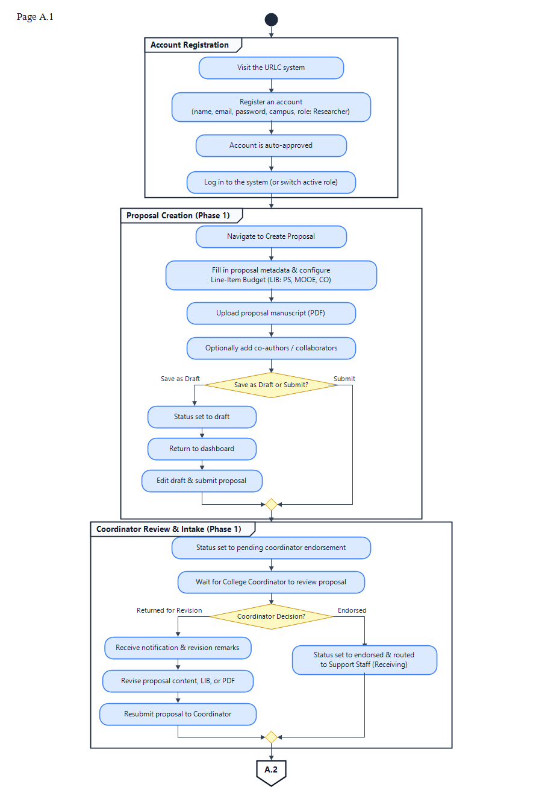

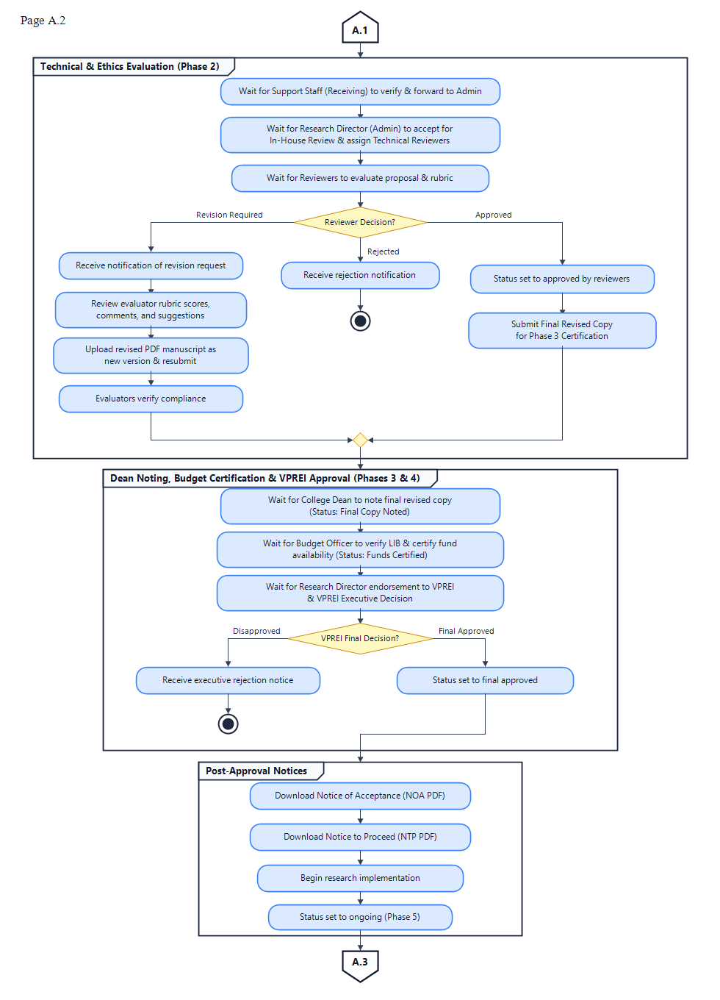

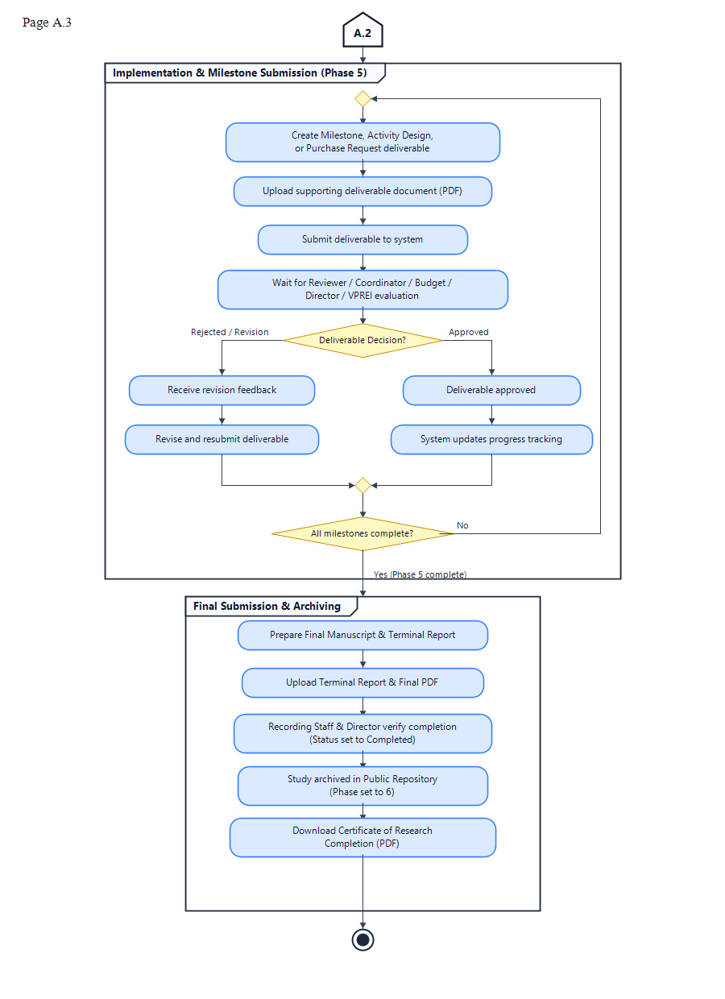

### Copy-Paste Academic Text for Chapter 3 (Figure 18)

**Figure 18. Researcher Activity Diagram**

The Researcher Activity Diagram illustrates the complete end-to-end workflow of a faculty researcher within the URLC System across all five institutional lifecycle phases, partitioned across `Page A.1`, `Page A.2`, and `Page A.3`. The flow begins with account registration (`role: Researcher`), which is automatically approved (`is_approved = true`) upon registration, followed by authentication into the Researcher Dashboard. If the researcher already has submitted proposals, they may inspect proposal statuses, evaluator feedback, and lifecycle progress; otherwise, an empty state prompts them to create a new research proposal.

During **Proposal Submission (Phase 1)** on `Page A.1`, the researcher encodes the proposal metadata (title, abstract, keywords, college, campus, research agenda alignment, and target timeline), constructs the dynamic **Line-Item Budget (LIB)** breakdown across Personal Services (PS), Maintenance and Other Operating Expenses (MOOE), and Capital Outlay (CO), and uploads the primary PDF manuscript. Upon submission, the proposal status is set to `submitted` and routed to the **College Research Coordinator** (and **College Dean** for initial college-level concurrence). If the Coordinator returns the manuscript for departmental revision, the researcher uploads an updated PDF revision (`ProposalRevision`) and resubmits until college endorsement (`endorsed`) is granted.

Continuing on `Page A.2`, during **Technical & Ethics Evaluation (Phase 2)**, the proposal is verified by **Support Staff (Receiving)** (`received`) and accepted by the **Research Director (Admin)** for In-House Review (`under_review`), where it is assigned to **Technical Reviewers / Evaluators**. If the evaluators request revisions (`revision_required`), the researcher reviews the rubric scores and line-by-line comments, uploads a revised PDF version, and resubmits for compliance verification. Once approved by the evaluators (`approved_by_reviewers`), the researcher submits the final revised copy to enter **Phase 3 (Dean Noting & Budget Certification)**. The **College Dean** notes the final revised manuscript (`final_copy_noted`), and the **Budget Officer** audits the Line-Item Budget and certifies fund availability (`funds_certified`). In **Phase 4 (Executive Approval)**, the **Research Director** endorses the complete dossier to the **Vice President for Research, Extension, and Innovation (VPREI)**. Upon the VPREI's **Final Executive Approval** (`final_approved`), the system automatically generates the official **Notice of Acceptance (NOA)** and **Notice to Proceed (NTP)** PDFs via DomPDF, which the researcher downloads before the project transitions to `ongoing` status (**Phase 5**).

On `Page A.3`, during **Implementation, Procurement & Completion (Phase 5)**, the researcher creates project milestones (`ProposalMilestone`) with supporting documents for reviewer evaluation, prepares **Activity Designs** and itemized **Purchase Requests (PR)** for financial and administrative clearance, and—once all milestones are approved—uploads the **Terminal Report** and final manuscript (`ProposalCompletionFile`). Following the Research Director's verification, the researcher downloads the official **Certificate of Research Completion** as the study is archived into the public institutional repository (`archived`). Finally, the researcher may engage with institutional announcements or manage their profile before logging out.

<strong>PlantUML & Mermaid Source Code – Researcher Activity Diagram</strong>

```plantuml
@startuml Researcher_Activity_Diagram
skinparam ActivityBackgroundColor #DBEAFE
skinparam ActivityBorderColor #3B82F6
skinparam ActivityDiamondBackgroundColor #FEF9C3
skinparam ActivityDiamondBorderColor #CA8A04
skinparam ArrowColor #334155

start
partition "Registration (Auto-Approved)" {
  :Visit URLC system and register account\n(name, email, password, campus, college, role: Researcher);
  :Account is automatically approved\n(is_approved = true for Researcher role);
  :Redirected to Researcher Dashboard;
}
partition "Authentication" {
  :Navigate to URLC system login page;
  :Enter email and password;
  :System validates credentials;
  :Researcher is logged in and redirected to dashboard;
}
partition "Proposal Submission & Phase 1 Endorsement" {
  :Click Submit New Proposal;
  :Fill in proposal details\n(title, abstract, keywords, college, research agenda, timeline);
  :Encode dynamic Line-Item Budget (LIB)\n(PS, MOOE, CO itemization) & upload PDF manuscript;
  :Submit proposal (Status: submitted);
  :Wait for College Coordinator review & initial Dean noting;
  if (Coordinator Decision?) then (Returned for Revision)
    :Receive return remarks & revise manuscript;
    :Upload revised PDF version & resubmit;
  else (Endorsed)
    :Status set to endorsed;
  endif
}
partition "Technical & Ethics Evaluation (Phase 2)" {
  :Wait for Support Staff (Receiving) to verify & forward to Admin;
  :Wait for Research Director (Admin) to accept for\nIn-House Review & assign Technical Reviewers;
  :Wait for Reviewers to evaluate proposal & rubric;
  switch (Reviewer Decision?)
  case (Revision Required)
    :Review evaluator rubric scores, comments, and suggestions;
    :Upload revised PDF manuscript as new version & resubmit;
    :Evaluators verify compliance;
  case (Rejected)
    :Receive rejection notification;
    stop
  case (Approved)
    :Status set to approved by reviewers;
    :Submit Final Revised Copy for Phase 3 Certification;
  endswitch
}
partition "Dean Noting, Budget Certification & VPREI Approval (Phases 3 & 4)" {
  :Wait for College Dean to note final revised copy (Status: Final Copy Noted);
  :Wait for Budget Officer to verify LIB & certify fund availability (Status: Funds Certified);
  :Wait for Research Director endorsement to VPREI & VPREI Executive Decision;
  if (VPREI Final Decision?) then (Disapproved)
    :Receive executive rejection notice;
    stop
  else (Final Approved)
    :Status set to final approved;
  endif
}
partition "Post-Approval Notices & Phase 5 Implementation" {
  :Download Notice of Acceptance (NOA PDF) & Notice to Proceed (NTP PDF);
  :Status set to ongoing (Phase 5);
  repeat
    :Create milestone with title, description & attachment;
    :Wait for Reviewer to evaluate milestone;
  repeat while (Milestone Approved?) is (No - Revise)
  if (Submit Activity Design or Purchase Request?) then (Yes)
    :Encode Activity Design / itemized Purchase Request (PR);
    :Route through Coordinator, Dean, Budget Officer, Director & VPREI;
  endif
  if (All milestones approved & ready to close?) then (Yes)
    :Upload Terminal Report & Final Manuscript (ProposalCompletionFile);
    :Research Director verifies & issues Certificate of Completion;
    :Status set to Completed / Archived in Public Repository;
  endif
}
stop
@enduml
```

---

## 2. College Coordinator Activity Diagram (`Page B.1 – Page B.2`)

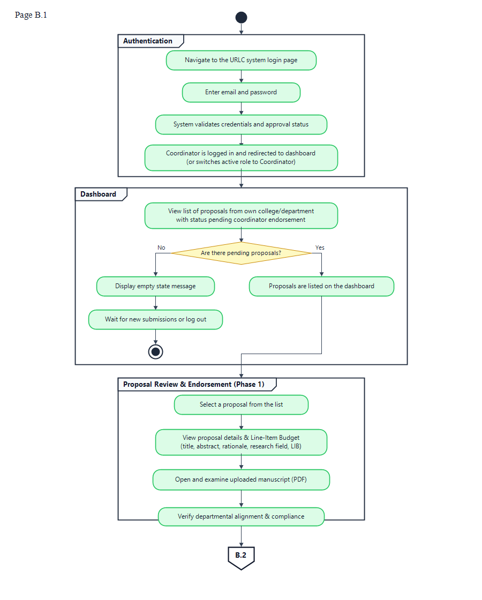

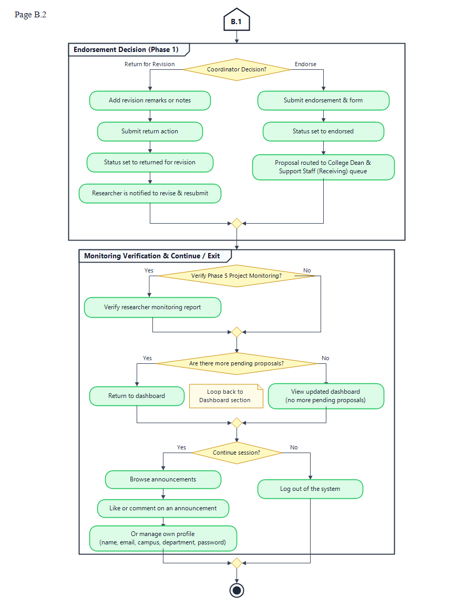

### Copy-Paste Academic Text for Chapter 3 (Figure 19)

**Figure 19. College Coordinator Activity Diagram**

The College Coordinator Activity Diagram (`Page B.1` and `Page B.2`) depicts the college-level screening and endorsement workflow executed by a College Research Coordinator. As an institutional staff role, a newly registered Coordinator account starts in a `pending` state (`is_approved = false`) until approved by the Super Admin. Once authenticated, the Coordinator accesses the College Dashboard (`Page B.1`), which filters and displays all proposals originating from the Coordinator's assigned college with a status of `submitted`.

On `Page B.2`, during **Proposal Review (Phase 1 Screening)**, the Coordinator selects a pending submission, inspects the research metadata, alignment with the college research agenda, and Line-Item Budget, and opens the attached PDF manuscript (alongside any prior revision history). Under **Endorsement Decision**, the Coordinator either returns the proposal for departmental revision (`returned_for_revision`) with specific remarks—notifying the Researcher to upload a corrected version—or endorses the proposal (`endorsed`), which forwards the submission to **Support Staff (Receiving)** (and logs college-level endorsement alongside the College Dean). Additionally, during **Phase 5**, the Coordinator may endorse college-level **Activity Designs** before continuing to review remaining college proposals, interacting with announcements, or logging out.

<strong>PlantUML Source Code – College Coordinator Activity Diagram</strong>

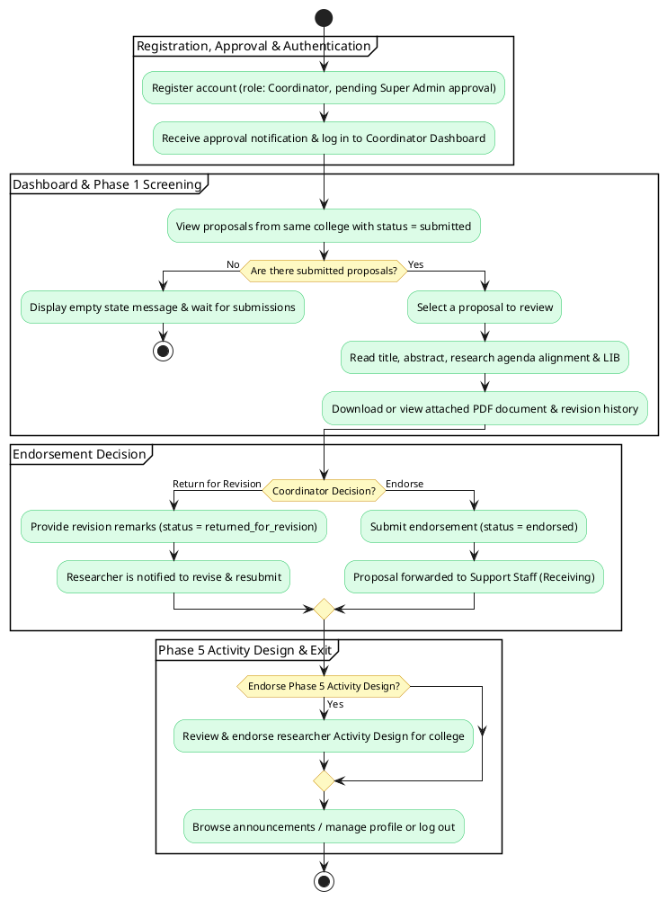

---

## 3. Support Staff (Receiving) Activity Diagram (`Page C.1 – Page C.2`)

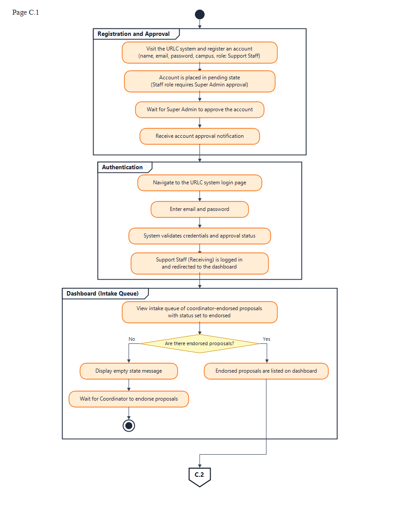

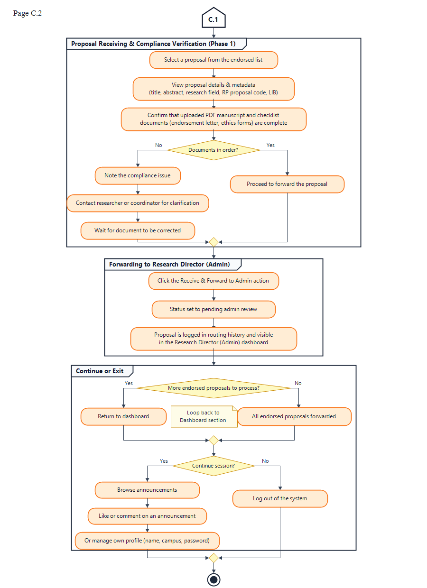

### Copy-Paste Academic Text for Chapter 3 (Figure 20)

**Figure 20. Support Staff (Receiving) Activity Diagram**

The Support Staff (Receiving) Activity Diagram (`Page C.1` and `Page C.2`) models the centralized intake and documentary completeness verification process at the URLC office. After Super Admin account approval and authentication (`Page C.1`), the Receiving Staff views the intake queue containing all college-endorsed proposals (`status = endorsed`). If no endorsed proposals are currently queued, an empty state is shown.

When endorsed proposals are available (`Page C.2`), the Receiving Staff selects a submission, verifies the completeness of the documentary requirements, attachments, and college endorsement metadata, and executes **Receive & Forward Proposal**. This action transitions the proposal status to `received`, records the intake timestamp (`received_at`), and forwards the proposal to the **Research Director (Admin)** for Phase 2 In-House Review acceptance and Technical Reviewer assignment.

<strong>PlantUML Source Code – Support Staff (Receiving) Activity Diagram</strong>

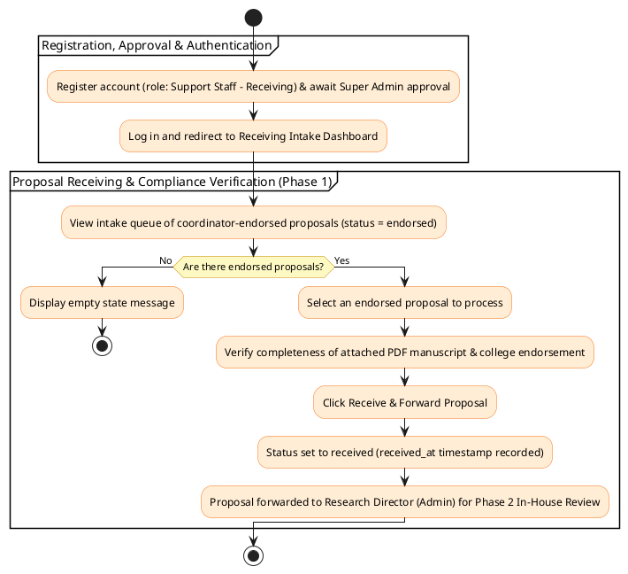

---

## 4. Technical Reviewer / Evaluator Activity Diagram (`Page D.1 – Page D.2`)

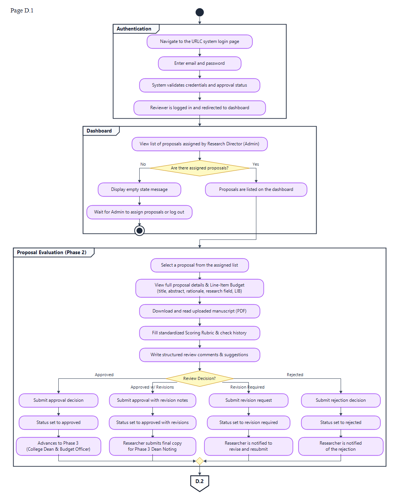

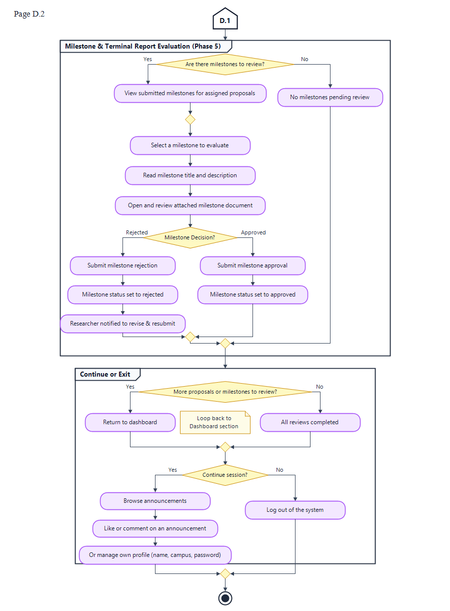

### Copy-Paste Academic Text for Chapter 3 (Figure 21)

**Figure 21. Technical Reviewer / Evaluator Activity Diagram**

The Technical Reviewer / Evaluator Activity Diagram (`Page D.1` and `Page D.2`) captures the peer-evaluation workflow during **Phase 2 (In-House & Ethics Review)** and **Phase 5 (Milestone Evaluation)**. Following Super Admin approval and login (`Page D.1`), the Reviewer views all proposals assigned to them by the Research Director (`status = under_review`). Selecting an assigned proposal allows the Reviewer to examine the manuscript, revision history, and Line-Item Budget, and to score the proposal using the standardized **Evaluation Rubric**. Under **Review Decision**, the Reviewer may:
1. **Submit a Comment** (recording qualitative feedback while keeping `status = under_review`),
2. **Approve the Proposal** (`status = approved_by_reviewers`), prompting the Researcher to upload the final revised manuscript for **Phase 3 College Dean Noting & Budget Officer Certification**,
3. **Request Revision** (`status = revision_required`), prompting the Researcher to upload a revised version for compliance re-verification, or
4. **Reject the Proposal** (`status = rejected`).

On `Page D.2`, during **Milestone & Terminal Report Evaluation (Phase 5)**, the Reviewer inspects submitted project milestones (`ProposalMilestone`) and attached deliverables for ongoing studies, either approving the milestone (`approved`) or rejecting it (`rejected`) with feedback for researcher revision.

<strong>PlantUML Source Code – Technical Reviewer Activity Diagram</strong>

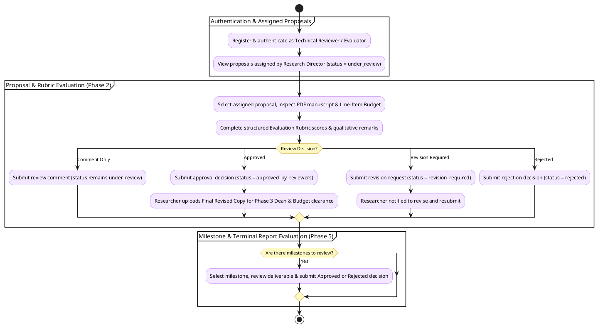

---

## 5. College Dean Activity Diagram (`Page E.1 – Page E.2`) *(NEW)*

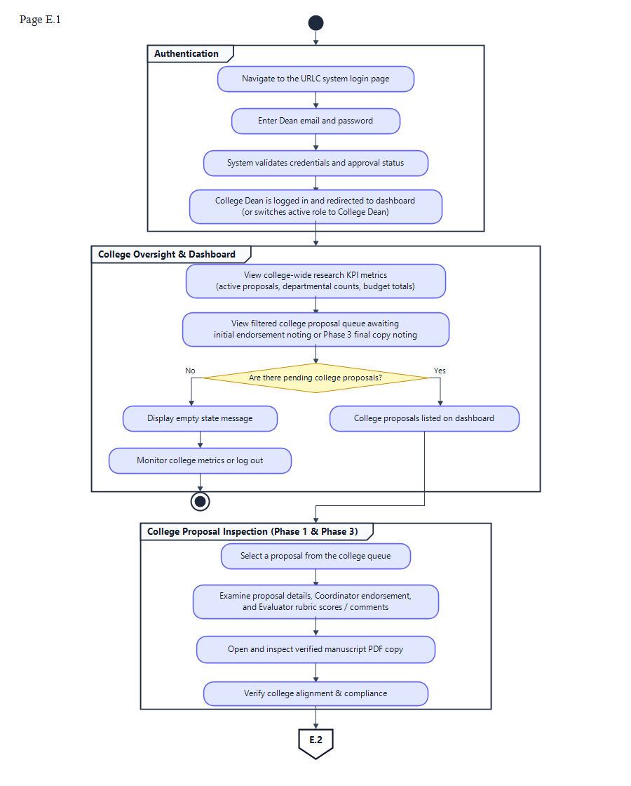

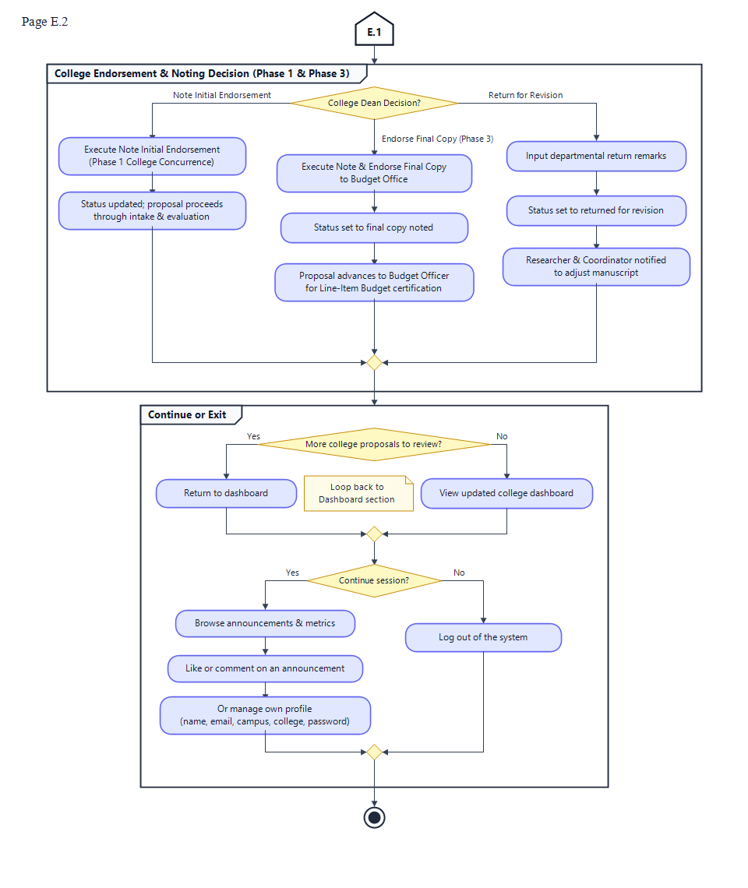

### Copy-Paste Academic Text for Chapter 3 (Figure 22)

**Figure 22. College Dean Activity Diagram**

The College Dean Activity Diagram (`Page E.1` and `Page E.2`) illustrates the managerial oversight and formal noting responsibilities of the College Dean within the URLC System. After Super Admin account approval and login (`Page E.1`), the Dean accesses the **College Dean Dashboard**, which aggregates college-level research metrics and lists proposals requiring either **Phase 1 Initial Endorsement Noting** or **Phase 3 Post-Evaluation Final Copy Noting**. Upon selecting a proposal, the Dean reviews the research abstract, Line-Item Budget (LIB), technical evaluator rubric clearances, and the researcher's final revised PDF manuscript.

On `Page E.2`, under **College Endorsement & Noting Decision (Phase 1 & Phase 3)**, the College Dean executes one of three actions:
1. **Note Initial Endorsement (Phase 1):** Records formal college concurrence (`dean_endorsed_at`) so the proposal proceeds through institutional intake and technical review.
2. **Note & Endorse Final Copy to Budget Office (Phase 3):** Formally notes the post-review final revised manuscript (`status = final_copy_noted`) and routes the proposal to the **Budget Officer** for Line-Item Budget verification and fund availability certification.
3. **Return for Revision:** Logs departmental return remarks (`status = returned_for_revision`), notifying the Researcher and Coordinator to adjust the manuscript.

<strong>PlantUML Source Code – College Dean Activity Diagram</strong>

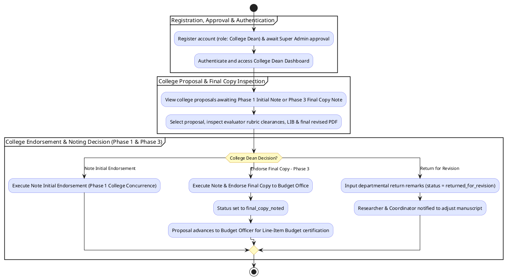

---

## 6. Budget Officer Activity Diagram (`Page F.1 – Page F.2`) *(NEW)*

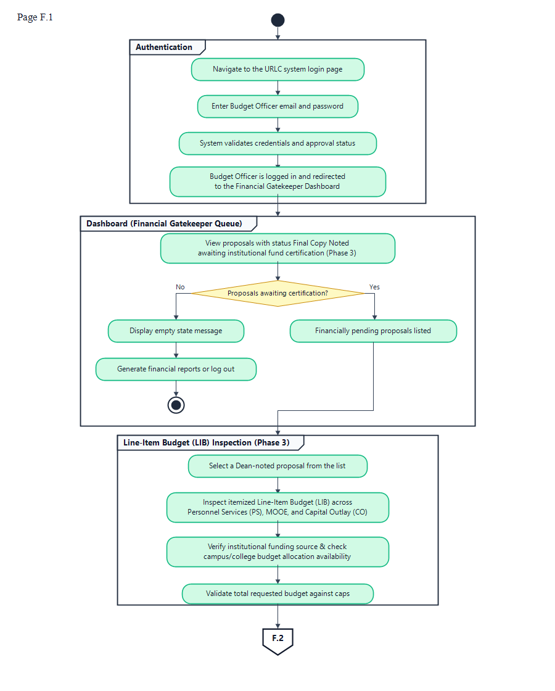

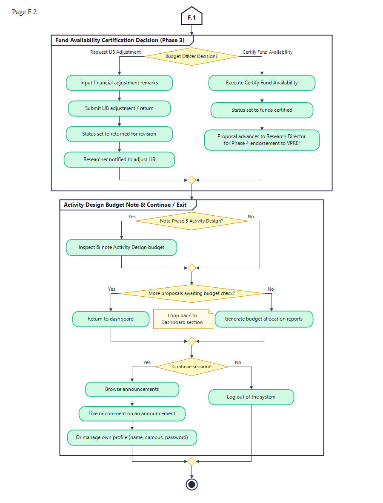

### Copy-Paste Academic Text for Chapter 3 (Figure 23)

**Figure 23. Budget Officer Activity Diagram**

The Budget Officer Activity Diagram (`Page F.1` and `Page F.2`) details the financial auditing and fund availability certification workflow during **Phase 3 (Budget Certification)** and **Phase 5 (Activity Design Budget Clearance)**. Following Super Admin approval and login (`Page F.1`), the Budget Officer views the queue of Dean-noted proposals (`status = final_copy_noted`) alongside institutional budget summaries. Selecting a proposal displays its itemized **Line-Item Budget (LIB)** across Personal Services (PS), Maintenance and Other Operating Expenses (MOOE), and Capital Outlay (CO), which the Budget Officer audits against institutional fund ceilings (*GAA*, *Local Trust Fund*, *Foreign Trust Fund*, and *Implementation Trust Fund*).

On `Page F.2`, under **Fund Availability Certification Decision (Phase 3)**, if financial discrepancies exist, the Budget Officer inputs financial adjustment remarks and returns the proposal (`returned_for_revision`) so the Researcher can revise the LIB. If the budget is compliant and funds are available, the Budget Officer executes **Certify Fund Availability**, updating the proposal status to `funds_certified` (`budget_certified_at`) and advancing the proposal to the **Research Director (Admin)** for **Phase 4 Endorsement to the VPREI**. The Budget Officer can also inspect and note **Phase 5 Activity Design** budgets and generate budget allocation reports before logging out.

<strong>PlantUML Source Code – Budget Officer Activity Diagram</strong>

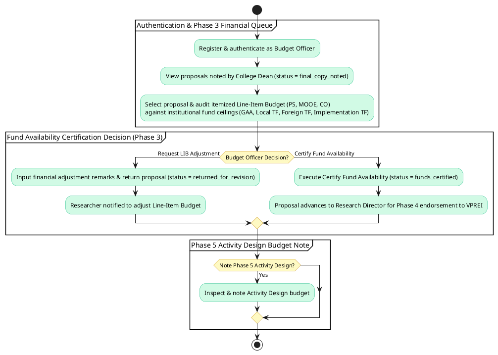

---

## 7. Support Staff (Recording) Activity Diagram (`Page G.1 – Page G.3`) *(UPDATED)*

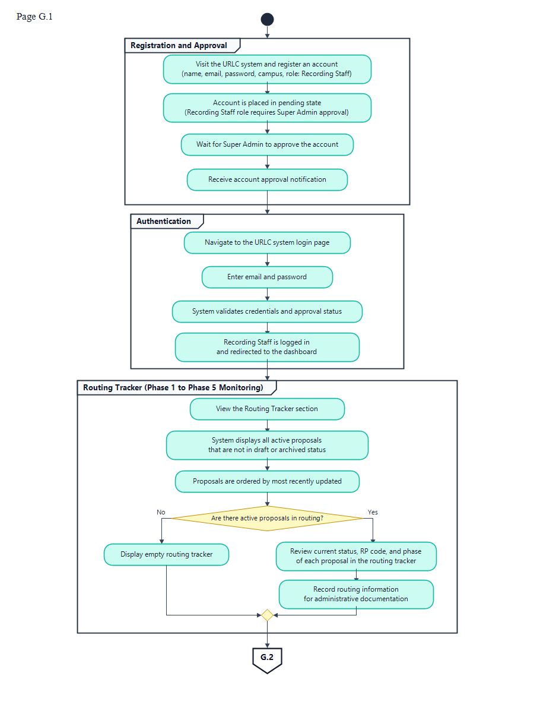

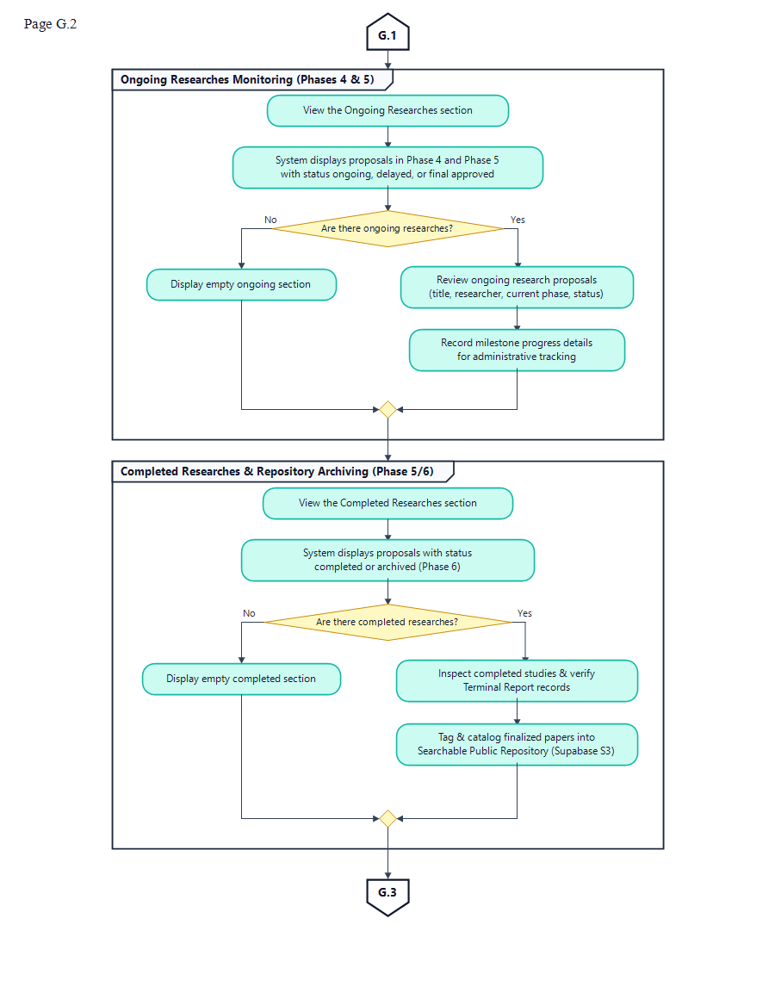

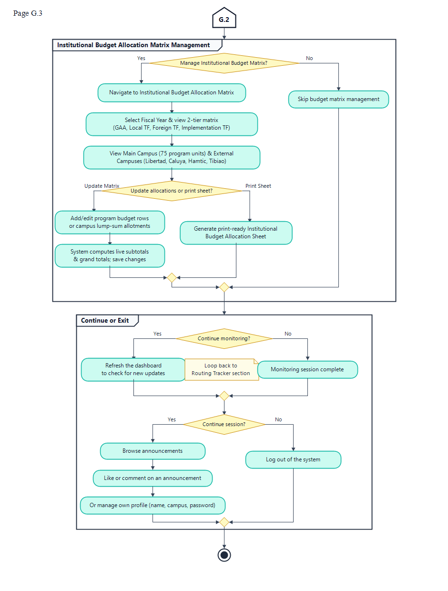

### Copy-Paste Academic Text for Chapter 3 (Figure 24)

**Figure 24. Support Staff (Recording) Activity Diagram**

The Support Staff (Recording) Activity Diagram (`Page G.1`, `Page G.2`, and `Page G.3`) illustrates the institutional monitoring, archival indexing, and multi-campus budget matrix administration performed by the Recording Staff. After Super Admin approval and authentication (`Page G.1`), the Recording Staff accesses the **Routing Tracker (Proposal Flow Monitor)**, which provides real-time visibility into every proposal across all statuses (`submitted`, `endorsed`, `received`, `under_review`, `approved_by_reviewers`, `final_copy_noted`, `funds_certified`, `endorsed_to_vprei`, `final_approved`, `ongoing`, `completed`, `archived`, `rejected`, and `returned_for_revision`), with multi-criteria filtering by lifecycle phase, status, or college.

On `Page G.2`, the Recording Staff monitors **Ongoing Researches (Phase 5)**—tracking active implementations across Phases 1 through 5 and inspecting milestone completion metrics—and manages **Completed Researches & Repository Archiving**, where completed studies and terminal reports can be exported (`CSV`/`PDF` registries) or cataloged into the public institutional repository.

On `Page G.3`, under **Institutional Budget Allocation Matrix Management**, the Recording Staff navigates to the two-tier **Institutional Budget Allocation Matrix**, selects a Fiscal Year, and manages fund allocations across the four institutional fund sources (**GAA**, **Local Trust Fund**, **Foreign Trust Fund**, and **Implementation Trust Fund**) covering **Main Campus** (75 active academic program units across 8 colleges and the Graduate School) and the four external campuses (**Libertad**, **Caluya**, **Hamtic**, and **Tibiao**). The Recording Staff can add or update program-level budget rows or campus lump-sum allotments with live subtotal and grand-total computation, or generate the print-ready **Institutional Budget Allocation Sheet**.

<strong>PlantUML Source Code – Support Staff (Recording) Activity Diagram</strong>

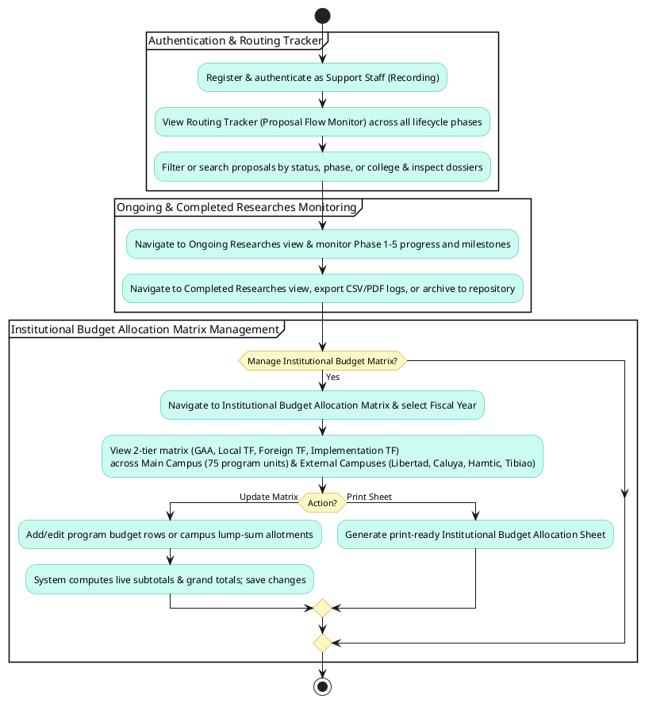

---

## 8. Admin / Research Director Activity Diagram (`Page H.1 – Page H.4`) *(UPDATED)*

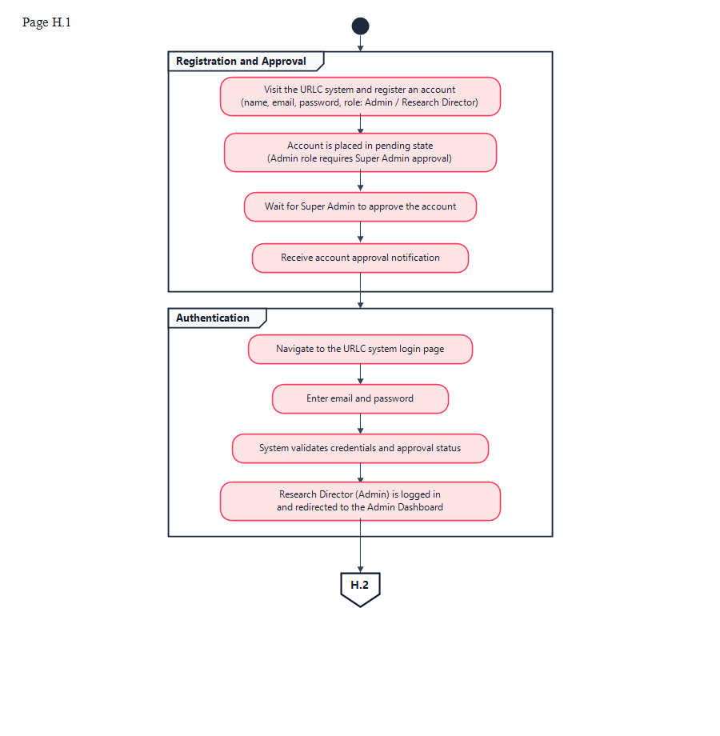

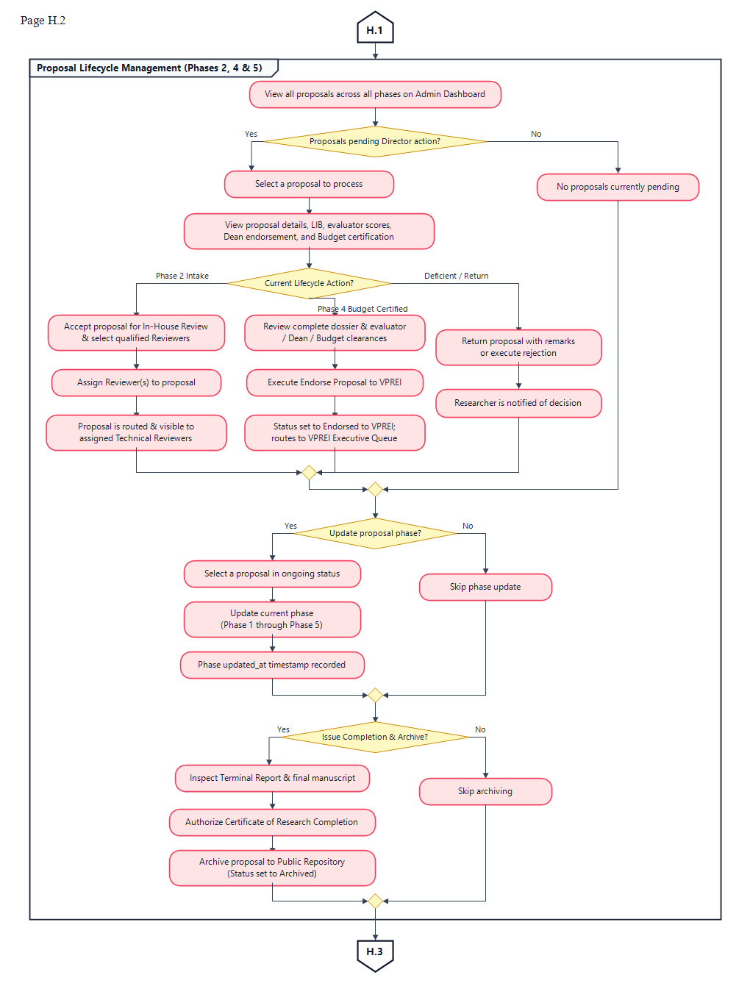

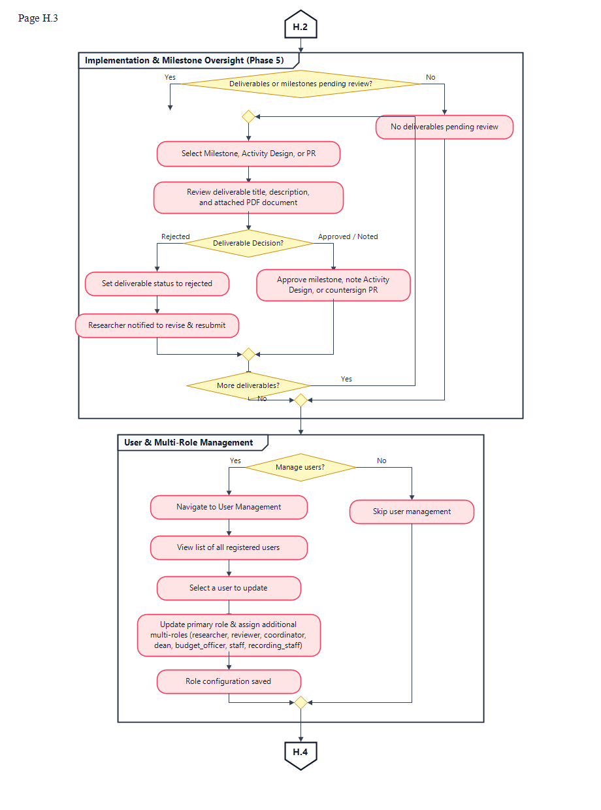

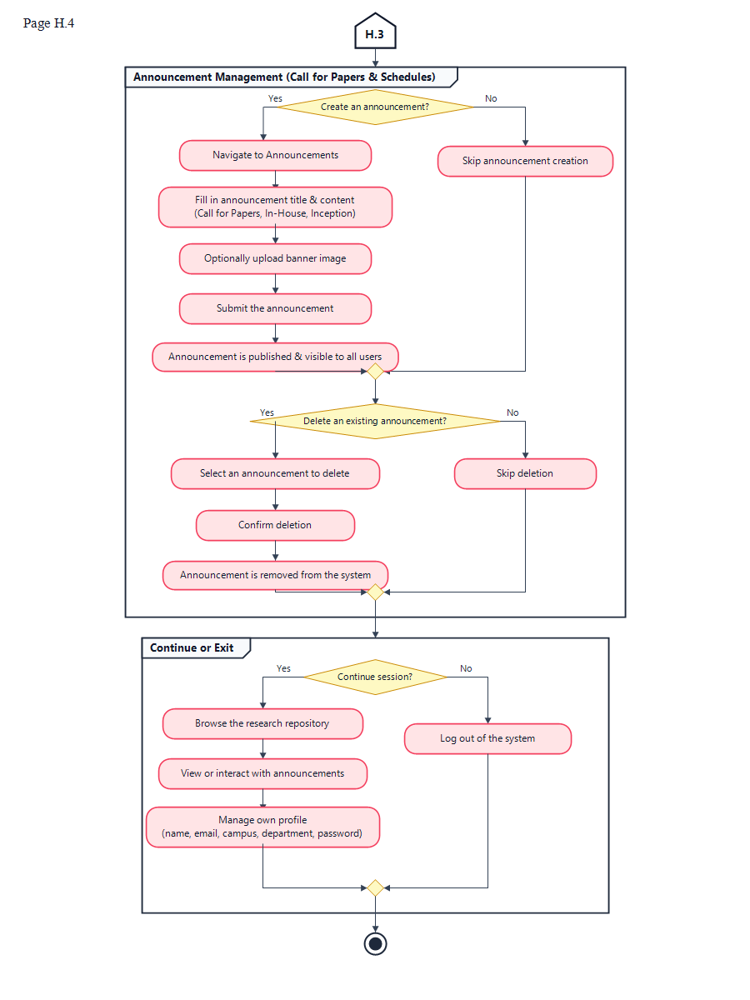

### Copy-Paste Academic Text for Chapter 3 (Figure 25)

**Figure 25. Admin / Research Director Activity Diagram**

The Admin / Research Director Activity Diagram (`Page H.1` through `Page H.4`) models the central governance, reviewer assignment, executive endorsement, and user administration functions of the Research Director (Admin). Following authentication (`Page H.1`), the Research Director accesses the **Admin Dashboard**, which displays global KPI counters across all statuses, pending user account approvals, and active proposals.

On `Page H.2`, under **Proposal Lifecycle Management (Phases 2, 4 & 5)**, the Research Director processes proposals at three critical institutional gates:
1. **Phase 2 Intake & Reviewer Assignment:** Accepts received proposals (`status = received`) for In-House Review (`under_review`) and assigns qualified **Technical Reviewers / Evaluators**.
2. **Phase 4 Executive Endorsement to VPREI:** Reviews the complete proposal dossier after evaluator approval, College Dean final noting, and Budget Officer fund certification (`status = funds_certified`), and executes **Endorse Proposal to VPREI** (`status = endorsed_to_vprei`), routing the dossier to the **VPREI Executive Queue**.
3. **Phase 5 Lifecycle Progression, Completion & Archiving:** Updates ongoing implementation phases (Phase 1 through Phase 5), inspects completed Terminal Reports, authorizes the **Certificate of Research Completion**, and archives completed studies into the public repository (`status = archived`).

On `Page H.3`, the Research Director oversees **Milestones, Activity Designs & Purchase Requests (Phase 5)** and administers **User & Multi-Role Account Management**, including approving pending institutional staff registrations (`Coordinator`, `Dean`, `Budget Officer`, `Reviewer`, `Support Staff`, `VPREI`), toggling active account statuses, and assigning primary or secondary multi-roles (while protecting Super Admin accounts). On `Page H.4`, the Research Director manages **Institutional Announcements** (creating, editing, or deleting announcements with image attachments) before concluding their session.

<strong>PlantUML Source Code – Admin / Research Director Activity Diagram</strong>

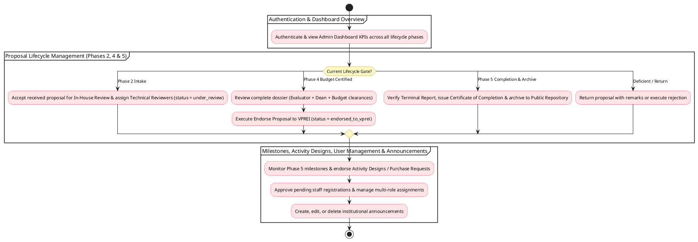

---

## 9. VPREI (Executive) Activity Diagram (`Page I.1 – Page I.2`) *(NEW)*

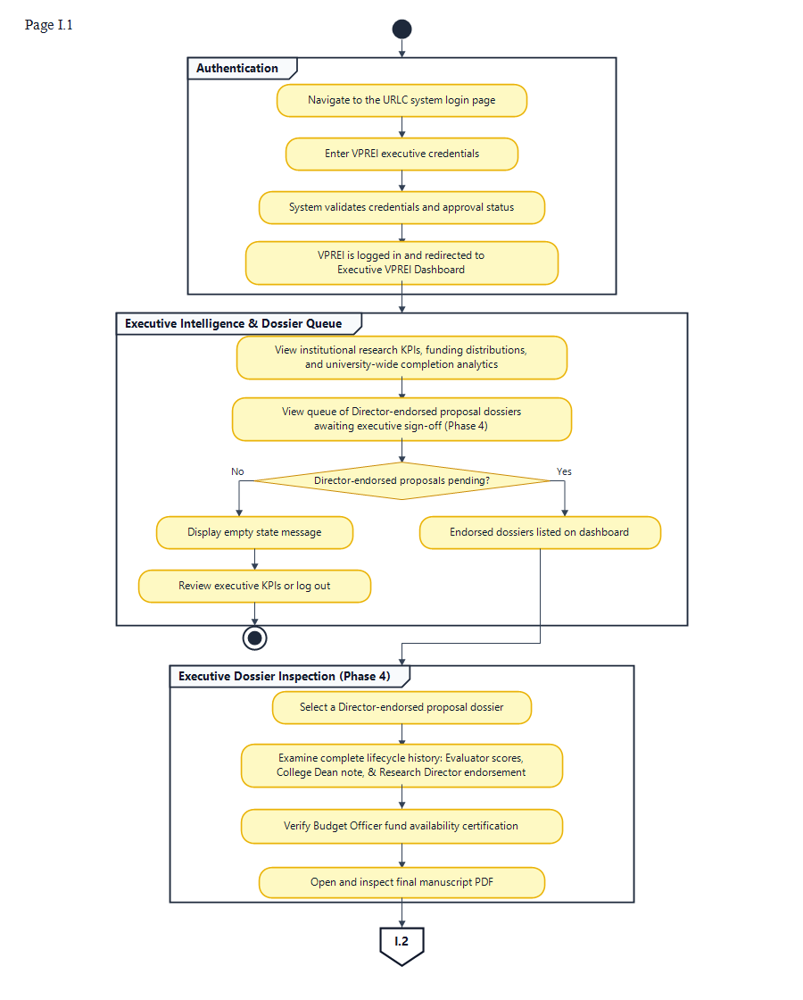

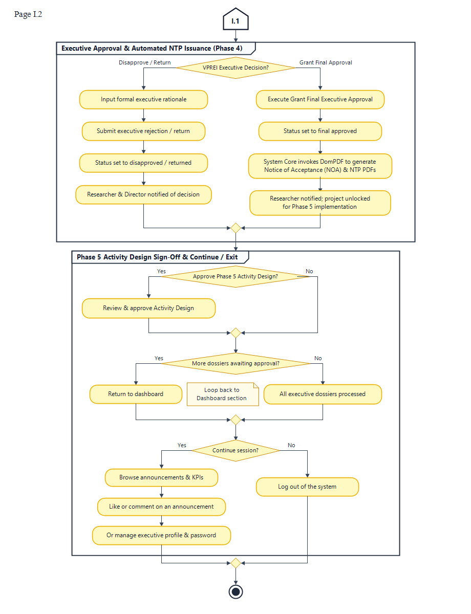

### Copy-Paste Academic Text for Chapter 3 (Figure 26)

**Figure 26. VPREI (Executive) Activity Diagram**

The VPREI (Executive) Activity Diagram (`Page I.1` and `Page I.2`) represents the executive decision-making and automated legal notice issuance workflow of the **Vice President for Research, Extension, and Innovation (VPREI)**. After Super Admin approval and login (`Page I.1`), the VPREI views the **Executive Dashboard**, which presents university-wide research KPIs, campus-level budget utilization, and the **Phase 4 Executive Dossier Queue** (`status = endorsed_to_vprei`). Selecting a dossier allows the VPREI to review the complete multi-stage audit trail, including Technical Evaluator rubric scores, the College Dean's final copy noting, the Budget Officer's fund availability certification, and the Research Director's formal endorsement.

On `Page I.2`, under **Executive Approval & Automated NTP Issuance (Phase 4)**, if the VPREI disapproves or returns the dossier, formal executive rationale is recorded (`status = rejected` or `returned_for_revision`). When the VPREI executes **Grant Final Executive Approval**, the proposal status transitions to `final_approved`, and the system core automatically invokes **DomPDF** to generate the official **Notice of Acceptance (NOA)** and **Notice to Proceed (NTP)** PDFs, unlocking the research project for **Phase 5 implementation**. The VPREI also provides executive sign-off on **Phase 5 Activity Designs** before logging out.

<strong>PlantUML Source Code – VPREI (Executive) Activity Diagram</strong>

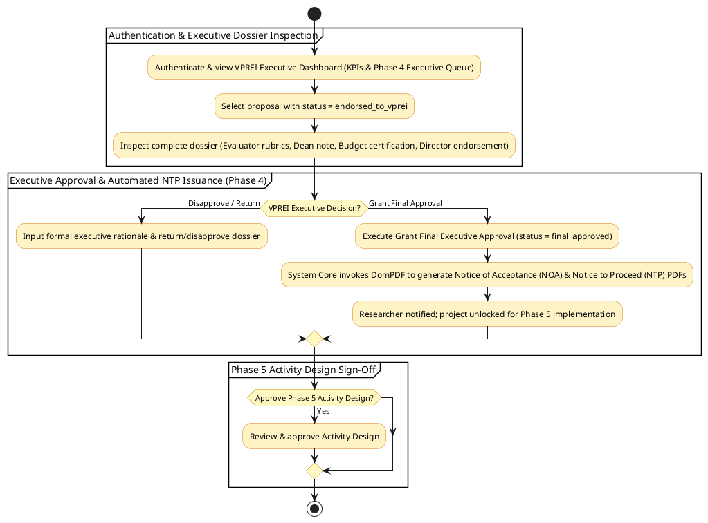

---

## 10. Super Admin Activity Diagram (`Page J.1 – Page J.3`) *(UPDATED)*

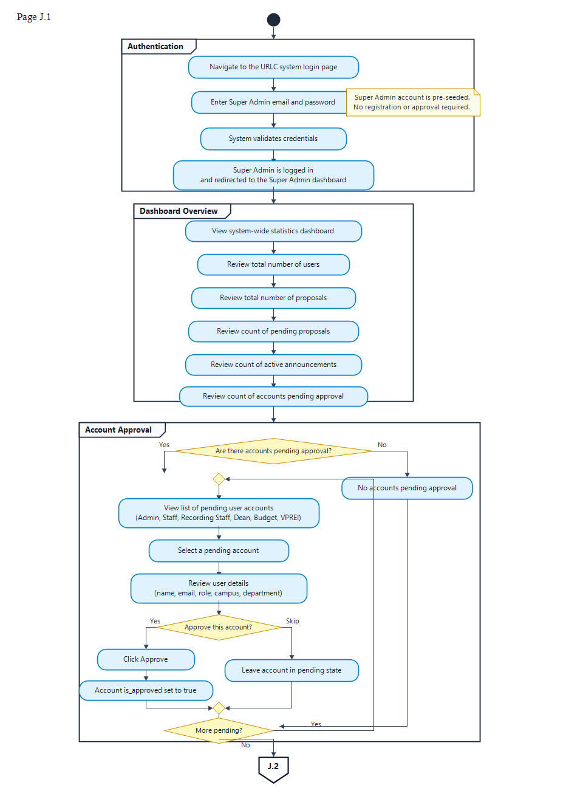

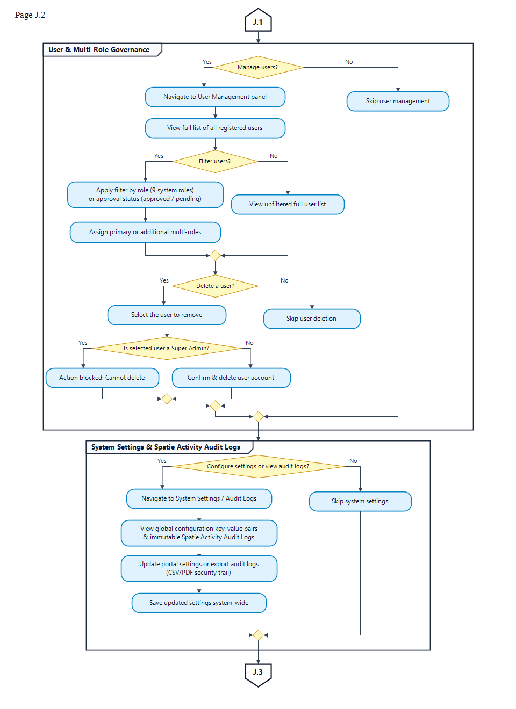

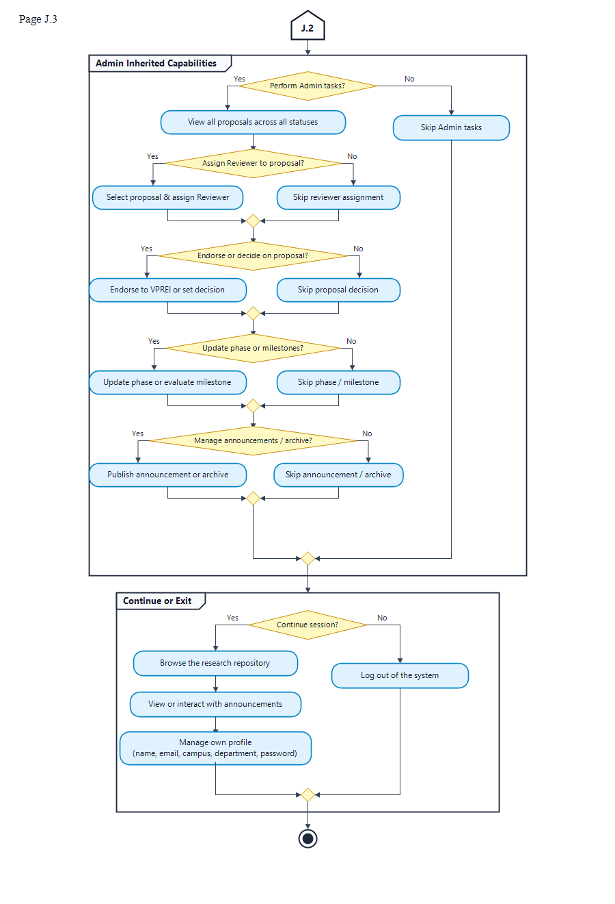

### Copy-Paste Academic Text for Chapter 3 (Figure 27)

**Figure 27. Super Admin Activity Diagram**

The Super Admin Activity Diagram (`Page J.1`, `Page J.2`, and `Page J.3`) illustrates the top-level system governance, multi-role access control, and security auditing workflow of the Super Admin. Unlike standard roles, the Super Admin account is pre-seeded via database migration (`DatabaseSeeder`) with `is_approved = true`. Upon authentication (`Page J.1`), the Super Admin views the **System Governance Dashboard**, displaying total users across all nine institutional roles, pending staff approval queues, system-wide proposal counters, and recent security events. The Super Admin reviews pending staff accounts (`Coordinator`, `Dean`, `Budget Officer`, `Reviewer`, `Support Staff`, `Admin`, `VPREI`) and approves or revokes access.

On `Page J.2`, under **User & Multi-Role Governance**, the Super Admin filters registered accounts by role or approval state, assigns primary or secondary multi-roles (`UserRole`), and deletes unauthorized user accounts (with built-in protection preventing the deletion of any Super Admin account). Under **System Settings & Spatie Activity Audit Logs**, the Super Admin manages global system configuration key-value pairs (`SystemSetting`) and inspects or exports the immutable **Spatie Activity Audit Logs** (`activity_log`) for security compliance.

On `Page J.3`, under **Admin Capabilities (Inherited)**, the Super Admin exercises full administrative privileges over the 5-phase proposal lifecycle (assigning reviewers, endorsing dossiers, updating phases, issuing completion certificates, and archiving studies) as well as institutional announcement management before logging out.

<strong>PlantUML Source Code – Super Admin Activity Diagram</strong>

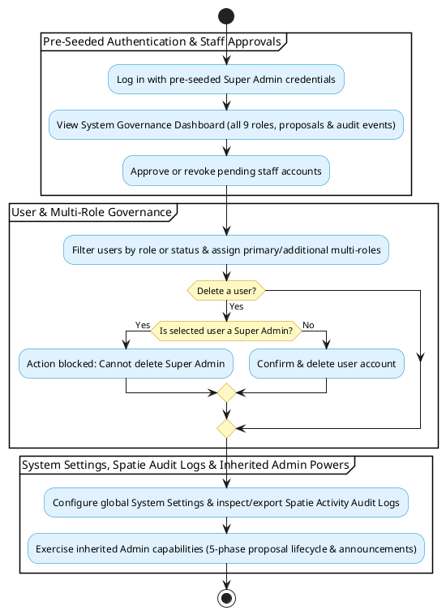

