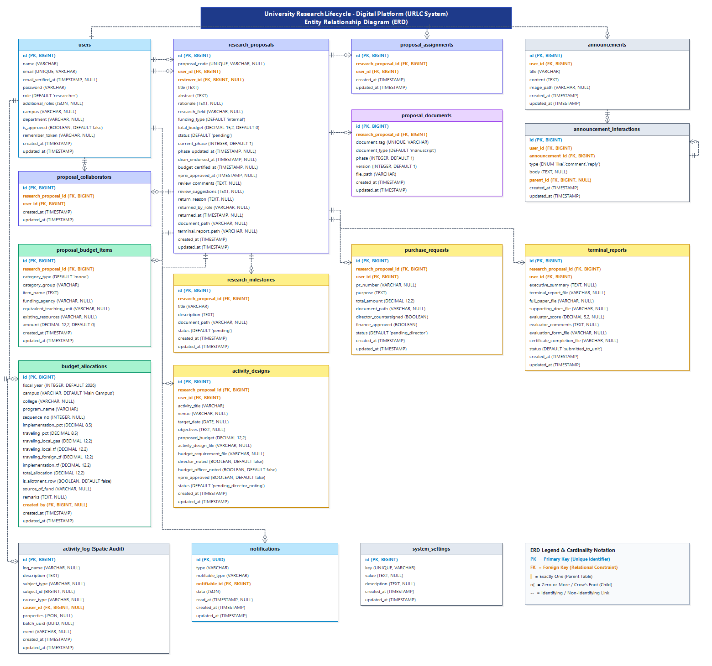

# Chapter 3: Entity Relationship Diagram (ERD) – URLC System

> **Document Classification**: System Documentation (Chapter 3: System Design & Architecture)  
> **Figure**: Figure 26 (Revised & Expanded from May 2026 10-Table Baseline)  
> **Print Optimization**: Proportioned for standard **Letter-size Paper (8.5" × 11") in Portrait Orientation** (Dimensions: 1560 × 1460 px, ~1.07:1 aspect ratio)  
> **Rendered Diagram**: ``

---

## 3.4 Entity Relationship Diagram

The **Entity Relationship Diagram (ERD)** presents the logical database schema and relational architecture underpinning the University Research Lifecycle - Digital Platform (URLC System). The schema is normalized up to the **Third Normal Form (3NF)** to ensure referential integrity, eliminate data redundancy, and maintain strict transactional consistency across all institutional research workflows.

The modernized schema expands the previous May 2026 10-table structure into a production-grade relational database comprising **16 primary relational tables** organized into four functional domains:

1. **User Identity, Multi-Role Access & Collaboration** (`users`, `proposal_collaborators`, `proposal_assignments`)
2. **Core Research Lifecycle & Digital Assets** (`research_proposals`, `proposal_documents`, `announcements`, `announcement_interactions`)
3. **Institutional Budget Matrix & Line-Item Budgeting** (`budget_allocations`, `proposal_budget_items`)
4. **Phase 5 Operations, Procurement & Project Closeout** (`research_milestones`, `activity_designs`, `purchase_requests`, `terminal_reports`)
5. **System Governance, Audit Trail & Notifications** (`activity_log`, `notifications`, `system_settings`)

---

## Visual Diagram

*Figure 26. Comprehensive Entity Relationship Diagram (ERD) of the URLC System (Letter-Size Portrait Ready)*

---

## 3.4.1 Architectural Narrative of Data Domains

### 1. User Identity, Multi-Role Governance & Collaboration Domain
- **`users` Table**: Acts as the central identity entity across all 9 institutional roles (Super Admin, Researcher, College Research Coordinator, College Dean, Support Staff / Receiving Officer, Evaluator / Reviewer, Budget Officer, Director, and VPREI). In addition to standard authentication attributes, the schema incorporates `additional_roles` (JSON) to facilitate multi-role execution without account duplication, `campus` and `department` for institutional scoping, and `is_approved` (Boolean) to govern administrative onboarding.
- **`proposal_collaborators` Table**: Implements a many-to-many (`M:N`) associative mapping between `research_proposals` and co-authoring `users`, allowing faculty teams to collectively author, view, and monitor research projects.
- **`proposal_assignments` Table**: Enforces the formal peer-review assignment pipeline by linking internal or external subject-matter `users` (as Evaluators/Reviewers) to specific `research_proposals`.

### 2. Research Proposal Lifecycle & Digital Repository Domain
- **`research_proposals` Table**: Serves as the central operational hub of the database. It captures comprehensive metadata (proposal code, title, abstract, rationale, research field, and funding type), lifecycle states (`status`, `current_phase`), and formal multi-stage approval timestamps (`dean_endorsed_at`, `budget_certified_at`, `vprei_approved_at`). It also maintains bidirectional feedback mechanisms through `review_comments`, `review_suggestions`, `return_reason`, `returned_by_role`, and `returned_at`.
- **`proposal_documents` Table**: Stores version-controlled digital artifacts throughout Phases 1 through 5. Every file record is stamped with a unique `document_tag`, `document_type` (e.g., manuscript, budget requirement, ethics clearance), corresponding `phase`, and numerical `version`.
- **`announcements` & `announcement_interactions` Tables**: Facilitate institutional call-for-proposals announcements, research memoranda, and threaded interactions (`likes`, `comments`, and recursive `replies` using `parent_id`).

### 3. Institutional Budget Matrix & Line-Item Budgeting (LIB) Domain
- **`budget_allocations` Table**: Implements the university-wide 2-tier research budget distribution matrix across 5 campuses and 75 academic programs. It tracks allocations across four distinct funding streams:
  1. *Traveling Expense - Local (GAA)*
  2. *Traveling Expense - Local (Trust Fund)*
  3. *Traveling Expense - Foreign (Trust Fund)*
  4. *Research Implementation (Trust Fund)*  
  It distinguishes summary allotment rows (`is_allotment_row`) from specific program allocations and records the authoring budget officer (`created_by`).
- **`proposal_budget_items` Table**: Models the detailed Line-Item Budget (LIB) submitted during Phase 1 and certified during Phase 2. Items are classified by expenditure classification:
  - **PS**: Personnel Services (with Equivalent Teaching Units / ETU)
  - **MOOE**: Maintenance and Other Operating Expenses
  - **CO**: Capital Outlay  
  Each item maintains an explicit `amount`, `category_group`, and `funding_agency`.

### 4. Phase 5 Implementation, Procurement & Project Closeout Domain
- **`research_milestones` Table**: Governs progress tracking for approved projects in Phase 5, recording progress reports, deliverables, and deliverable approval statuses.
- **`activity_designs` Table**: Manages off-campus and on-campus research activity design proposals (Forms HRU-FM-021 & BU-FM-006). It incorporates three-stage sequential approval flags: `director_noted`, `budget_officer_noted`, and `vprei_approved`.
- **`purchase_requests` Table**: Tracks procurement processes for approved equipment, supplies, and contracted services. It captures the unique `pr_number`, expenditure `purpose`, `total_amount`, and approval flags (`director_countersigned` and `finance_approved`).
- **`terminal_reports` Table**: Governs Phase 5 project completion and institutional archiving. It records executive summaries, evaluator scores (`evaluator_score`), terminal report manuscripts, full publishable research papers, evaluation forms, and Dean/Director-signed Certificates of Completion (`certificate_completion_file`).

### 5. Governance, Audit Trail & Communication Domain
- **`activity_log` Table**: Implemented via Spatie Activitylog to maintain an immutable, forensically auditable log of every create, update, delete, endorsement, approval, and rejection action across the platform. It captures `subject_type`, `subject_id`, `causer_type`, `causer_id`, event name, batch UUID, and full old/new JSON state diffs (`properties`).
- **`notifications` Table**: Powers the transactional notification center (UUID PK), routing real-time and email alerts to relevant stakeholders whenever a proposal moves through the workflow.
- **`system_settings` Table**: Stores global platform configurations, call-for-proposal submission deadlines, and campus constants as dynamic key-value pairs.

---

## 3.4.2 Relational Entity Data Dictionary

### Table 1: `users`
| Column Name | Data Type | Constraint | Nullable | Default | Description |
|---|---|---|---|---|---|
| `id` | BIGINT UNSIGNED | PK, Auto Increment | No | - | Unique user identifier |
| `name` | VARCHAR(255) | - | No | - | Full name of the user |
| `email` | VARCHAR(255) | UNIQUE | No | - | University institutional email address |
| `email_verified_at` | TIMESTAMP | - | Yes | NULL | Verification timestamp |
| `password` | VARCHAR(255) | - | No | - | Bcrypt hashed password |
| `role` | VARCHAR(50) | - | No | 'researcher' | Primary institutional role |
| `additional_roles` | JSON | - | Yes | NULL | Array of secondary roles assigned to user |
| `campus` | VARCHAR(100) | - | Yes | NULL | Campus affiliation |
| `department` | VARCHAR(150) | - | Yes | NULL | Department or college unit |
| `is_approved` | BOOLEAN | - | No | FALSE | Account authorization status |
| `remember_token` | VARCHAR(100) | - | Yes | NULL | Session persistence token |
| `created_at` | TIMESTAMP | - | Yes | NULL | Record creation timestamp |
| `updated_at` | TIMESTAMP | - | Yes | NULL | Record last update timestamp |

### Table 2: `research_proposals`
| Column Name | Data Type | Constraint | Nullable | Default | Description |
|---|---|---|---|---|---|
| `id` | BIGINT UNSIGNED | PK, Auto Increment | No | - | Unique proposal identifier |
| `proposal_code` | VARCHAR(50) | UNIQUE | Yes | NULL | Human-readable proposal tracking code |
| `user_id` | BIGINT UNSIGNED | FK (`users.id`) | No | - | Lead researcher/proponent user ID |
| `reviewer_id` | BIGINT UNSIGNED | FK (`users.id`) | Yes | NULL | Assigned peer evaluator/reviewer user ID |
| `title` | TEXT | - | No | - | Complete title of the research proposal |
| `abstract` | TEXT | - | No | - | Structured research summary / abstract |
| `rationale` | TEXT | - | Yes | NULL | Background, significance, and problem statement |
| `research_field` | VARCHAR(150) | - | Yes | NULL | Academic discipline / research agenda cluster |
| `funding_type` | VARCHAR(50) | - | No | 'internal' | Funding classification (`internal`, `external`) |
| `total_budget` | DECIMAL(15,2) | - | No | 0.00 | Total calculated Line-Item Budget |
| `status` | VARCHAR(50) | - | No | 'pending' | Workflow status (draft, pending, endorsed, approved, rejected) |
| `current_phase` | INTEGER | - | No | 1 | Research lifecycle phase (1 to 5) |
| `phase_updated_at` | TIMESTAMP | - | Yes | NULL | Timestamp of last lifecycle phase transition |
| `dean_endorsed_at` | TIMESTAMP | - | Yes | NULL | Timestamp of College Dean endorsement |
| `budget_certified_at`| TIMESTAMP | - | Yes | NULL | Timestamp of Budget Officer fund certification |
| `vprei_approved_at` | TIMESTAMP | - | Yes | NULL | Timestamp of VPREI executive approval |
| `review_comments` | TEXT | - | Yes | NULL | Evaluator review summary notes |
| `review_suggestions`| TEXT | - | Yes | NULL | Evaluator itemized recommendations |
| `return_reason` | TEXT | - | Yes | NULL | Justification remarks when proposal is returned |
| `returned_by_role` | VARCHAR(50) | - | Yes | NULL | Institutional role that initiated the return |
| `returned_at` | TIMESTAMP | - | Yes | NULL | Timestamp when returned for revision |
| `document_path` | VARCHAR(255) | - | Yes | NULL | Active proposal manuscript file path |
| `terminal_report_path`| VARCHAR(255)| - | Yes | NULL | Final terminal report file path |
| `created_at` | TIMESTAMP | - | Yes | NULL | Record creation timestamp |
| `updated_at` | TIMESTAMP | - | Yes | NULL | Record update timestamp |

### Table 3: `proposal_collaborators`
| Column Name | Data Type | Constraint | Nullable | Default | Description |
|---|---|---|---|---|---|
| `id` | BIGINT UNSIGNED | PK, Auto Increment | No | - | Unique collaborator mapping ID |
| `research_proposal_id`| BIGINT UNSIGNED| FK (`research_proposals.id`)| No | - | Relational proposal reference |
| `user_id` | BIGINT UNSIGNED | FK (`users.id`) | No | - | Co-author / collaborator user ID |
| `created_at` | TIMESTAMP | - | Yes | NULL | Record creation timestamp |
| `updated_at` | TIMESTAMP | - | Yes | NULL | Record update timestamp |

### Table 4: `proposal_assignments`
| Column Name | Data Type | Constraint | Nullable | Default | Description |
|---|---|---|---|---|---|
| `id` | BIGINT UNSIGNED | PK, Auto Increment | No | - | Unique assignment record ID |
| `research_proposal_id`| BIGINT UNSIGNED| FK (`research_proposals.id`)| No | - | Proposal under evaluation |
| `user_id` | BIGINT UNSIGNED | FK (`users.id`) | No | - | Assigned reviewer / evaluator |
| `created_at` | TIMESTAMP | - | Yes | NULL | Record creation timestamp |
| `updated_at` | TIMESTAMP | - | Yes | NULL | Record update timestamp |

### Table 5: `proposal_documents`
| Column Name | Data Type | Constraint | Nullable | Default | Description |
|---|---|---|---|---|---|
| `id` | BIGINT UNSIGNED | PK, Auto Increment | No | - | Unique document record ID |
| `research_proposal_id`| BIGINT UNSIGNED| FK (`research_proposals.id`)| No | - | Relational proposal ID |
| `document_tag` | VARCHAR(100) | UNIQUE | No | - | Unique file identification code |
| `document_type` | VARCHAR(50) | - | No | 'manuscript' | Document category (manuscript, budget, endorsement) |
| `phase` | INTEGER | - | No | 1 | Lifecycle phase when document was uploaded |
| `version` | INTEGER | - | No | 1 | Version counter for file revisions |
| `file_path` | VARCHAR(255) | - | No | - | Physical storage path on server |
| `created_at` | TIMESTAMP | - | Yes | NULL | Record creation timestamp |
| `updated_at` | TIMESTAMP | - | Yes | NULL | Record update timestamp |

### Table 6: `proposal_budget_items`
| Column Name | Data Type | Constraint | Nullable | Default | Description |
|---|---|---|---|---|---|
| `id` | BIGINT UNSIGNED | PK, Auto Increment | No | - | Unique budget line item ID |
| `research_proposal_id`| BIGINT UNSIGNED| FK (`research_proposals.id`)| No | - | Associated proposal ID |
| `category_type` | VARCHAR(20) | - | No | 'mooe' | Expenditure classification (`ps`, `mooe`, `co`) |
| `category_group` | VARCHAR(100) | - | No | - | Subcategory (e.g., Supplies, Travel, Honoraria) |
| `item_name` | TEXT | - | No | - | Detailed item description / justification |
| `funding_agency` | VARCHAR(150) | - | Yes | NULL | Source funding body |
| `equivalent_teaching_unit`| VARCHAR(50)| - | Yes | NULL | Teaching unit equivalent for faculty workload |
| `existing_resources`| VARCHAR(255)| - | Yes | NULL | Available university resources utilized |
| `amount` | DECIMAL(12,2) | - | No | 0.00 | Allocated budget item cost (PHP) |
| `created_at` | TIMESTAMP | - | Yes | NULL | Record creation timestamp |
| `updated_at` | TIMESTAMP | - | Yes | NULL | Record update timestamp |

### Table 7: `budget_allocations`
| Column Name | Data Type | Constraint | Nullable | Default | Description |
|---|---|---|---|---|---|
| `id` | BIGINT UNSIGNED | PK, Auto Increment | No | - | Unique allocation entry ID |
| `fiscal_year` | INTEGER | - | No | 2026 | Fiscal year of budget allocation |
| `campus` | VARCHAR(100) | - | No | 'Main Campus' | Target university campus |
| `college` | VARCHAR(150) | - | Yes | NULL | Academic college / division |
| `program_name` | VARCHAR(200) | - | No | - | Degree or research program name |
| `sequence_no` | INTEGER | - | Yes | NULL | Display sequence within matrix |
| `implementation_pct`| DECIMAL(8,5)| - | No | 0.00000 | Proportion allocated to project implementation |
| `traveling_pct` | DECIMAL(8,5)| - | No | 0.00000 | Proportion allocated to research travel |
| `traveling_local_gaa`| DECIMAL(12,2)| - | No | 0.00 | Traveling Local GAA fund amount |
| `traveling_local_tf` | DECIMAL(12,2)| - | No | 0.00 | Traveling Local Trust Fund amount |
| `traveling_foreign_tf`| DECIMAL(12,2)| - | No | 0.00 | Traveling Foreign Trust Fund amount |
| `implementation_tf` | DECIMAL(12,2)| - | No | 0.00 | Research Implementation Trust Fund amount |
| `total_allocation` | DECIMAL(12,2)| - | No | 0.00 | Total aggregate budget allocation |
| `is_allotment_row` | BOOLEAN | - | No | FALSE | Distinguishes allotment summary vs program row |
| `source_of_fund` | VARCHAR(100) | - | Yes | NULL | Originating fund category |
| `remarks` | TEXT | - | Yes | NULL | Budget officer notes and justifications |
| `created_by` | BIGINT UNSIGNED | FK (`users.id`)| Yes | NULL | User ID of authoring Budget Officer |
| `created_at` | TIMESTAMP | - | Yes | NULL | Record creation timestamp |
| `updated_at` | TIMESTAMP | - | Yes | NULL | Record update timestamp |

### Table 8: `research_milestones`
| Column Name | Data Type | Constraint | Nullable | Default | Description |
|---|---|---|---|---|---|
| `id` | BIGINT UNSIGNED | PK, Auto Increment | No | - | Unique milestone ID |
| `research_proposal_id`| BIGINT UNSIGNED| FK (`research_proposals.id`)| No | - | Relational proposal ID |
| `title` | VARCHAR(255) | - | No | - | Milestone deliverable title |
| `description` | TEXT | - | No | - | Scope of progress milestone |
| `document_path` | VARCHAR(255) | - | Yes | NULL | Milestone progress report file path |
| `status` | VARCHAR(50) | - | No | 'pending' | Milestone verification status |
| `created_at` | TIMESTAMP | - | Yes | NULL | Record creation timestamp |
| `updated_at` | TIMESTAMP | - | Yes | NULL | Record update timestamp |

### Table 9: `activity_designs`
| Column Name | Data Type | Constraint | Nullable | Default | Description |
|---|---|---|---|---|---|
| `id` | BIGINT UNSIGNED | PK, Auto Increment | No | - | Unique activity design ID |
| `research_proposal_id`| BIGINT UNSIGNED| FK (`research_proposals.id`)| No | - | Associated proposal ID |
| `user_id` | BIGINT UNSIGNED | FK (`users.id`) | No | - | Proponent user ID |
| `activity_title` | VARCHAR(255) | - | No | - | Title of research event/fieldwork |
| `venue` | VARCHAR(255) | - | Yes | NULL | Location of activity execution |
| `target_date` | DATE | - | Yes | NULL | Scheduled execution date |
| `objectives` | TEXT | - | Yes | NULL | Activity targets and expected output |
| `proposed_budget` | DECIMAL(12,2) | - | No | 0.00 | Estimated budget requirement |
| `activity_design_file`| VARCHAR(255)| - | Yes | NULL | Uploaded Form HRU-FM-021 file |
| `budget_requirement_file`| VARCHAR(255)| - | Yes | NULL | Uploaded Form BU-FM-006 file |
| `director_noted` | BOOLEAN | - | No | FALSE | Director noting signature flag |
| `budget_officer_noted`| BOOLEAN | - | No | FALSE | Budget Officer fund availability flag |
| `vprei_approved` | BOOLEAN | - | No | FALSE | VPREI executive approval flag |
| `status` | VARCHAR(50) | - | No | 'pending_director_noting' | Sequential approval status |
| `created_at` | TIMESTAMP | - | Yes | NULL | Record creation timestamp |
| `updated_at` | TIMESTAMP | - | Yes | NULL | Record update timestamp |

### Table 10: `purchase_requests`
| Column Name | Data Type | Constraint | Nullable | Default | Description |
|---|---|---|---|---|---|
| `id` | BIGINT UNSIGNED | PK, Auto Increment | No | - | Unique purchase request ID |
| `research_proposal_id`| BIGINT UNSIGNED| FK (`research_proposals.id`)| No | - | Associated research project ID |
| `user_id` | BIGINT UNSIGNED | FK (`users.id`) | No | - | Submitting proponent user ID |
| `pr_number` | VARCHAR(100) | - | Yes | NULL | Official university PR control number |
| `purpose` | TEXT | - | No | - | Procurement justification / item list |
| `total_amount` | DECIMAL(12,2) | - | No | 0.00 | Total requisition cost |
| `document_path` | VARCHAR(255) | - | Yes | NULL | Uploaded scanned PR document |
| `director_countersigned`| BOOLEAN | - | No | FALSE | Director countersignature status |
| `finance_approved` | BOOLEAN | - | No | FALSE | Finance division authorization flag |
| `status` | VARCHAR(50) | - | No | 'pending_director' | Procurement approval state |
| `created_at` | TIMESTAMP | - | Yes | NULL | Record creation timestamp |
| `updated_at` | TIMESTAMP | - | Yes | NULL | Record update timestamp |

### Table 11: `terminal_reports`
| Column Name | Data Type | Constraint | Nullable | Default | Description |
|---|---|---|---|---|---|
| `id` | BIGINT UNSIGNED | PK, Auto Increment | No | - | Unique terminal report ID |
| `research_proposal_id`| BIGINT UNSIGNED| FK (`research_proposals.id`)| No | - | Completed research proposal ID |
| `user_id` | BIGINT UNSIGNED | FK (`users.id`) | No | - | Lead researcher user ID |
| `executive_summary` | TEXT | - | Yes | NULL | Project completion executive summary |
| `terminal_report_file`| VARCHAR(255)| - | Yes | NULL | Official comprehensive terminal report file |
| `full_paper_file` | VARCHAR(255) | - | Yes | NULL | Publishable journal manuscript file |
| `supporting_docs_file`| VARCHAR(255)| - | Yes | NULL | Financial liquidation & receipts archive |
| `evaluator_score` | DECIMAL(5,2) | - | Yes | NULL | Numerical terminal evaluation score |
| `evaluator_comments`| TEXT | - | Yes | NULL | Evaluator completion remarks |
| `evaluation_form_file`| VARCHAR(255)| - | Yes | NULL | Scanned signed evaluation matrix |
| `certificate_completion_file`| VARCHAR(255)| - | Yes | NULL | Dean/Director signed completion certificate |
| `status` | VARCHAR(50) | - | No | 'submitted_to_unit' | Final archival verification status |
| `created_at` | TIMESTAMP | - | Yes | NULL | Record creation timestamp |
| `updated_at` | TIMESTAMP | - | Yes | NULL | Record update timestamp |

### Table 12: `announcements`
| Column Name | Data Type | Constraint | Nullable | Default | Description |
|---|---|---|---|---|---|
| `id` | BIGINT UNSIGNED | PK, Auto Increment | No | - | Unique announcement ID |
| `user_id` | BIGINT UNSIGNED | FK (`users.id`) | No | - | Authoring administrative user ID |
| `title` | VARCHAR(255) | - | No | - | Headline of announcement |
| `content` | TEXT | - | No | - | Complete body text of notification |
| `image_path` | VARCHAR(255) | - | Yes | NULL | Optional banner image file path |
| `created_at` | TIMESTAMP | - | Yes | NULL | Record creation timestamp |
| `updated_at` | TIMESTAMP | - | Yes | NULL | Record update timestamp |

### Table 13: `announcement_interactions`
| Column Name | Data Type | Constraint | Nullable | Default | Description |
|---|---|---|---|---|---|
| `id` | BIGINT UNSIGNED | PK, Auto Increment | No | - | Unique interaction record ID |
| `user_id` | BIGINT UNSIGNED | FK (`users.id`) | No | - | Interacting user ID |
| `announcement_id` | BIGINT UNSIGNED | FK (`announcements.id`)| No | - | Target announcement ID |
| `type` | ENUM | - | No | 'comment' | Interaction type (`like`, `comment`, `reply`) |
| `body` | TEXT | - | Yes | NULL | Comment or reply text |
| `parent_id` | BIGINT UNSIGNED | FK (`announcement_interactions.id`)| Yes | NULL | Self-referencing FK for nested replies |
| `created_at` | TIMESTAMP | - | Yes | NULL | Record creation timestamp |
| `updated_at` | TIMESTAMP | - | Yes | NULL | Record update timestamp |

### Table 14: `activity_log` (Spatie Audit)
| Column Name | Data Type | Constraint | Nullable | Default | Description |
|---|---|---|---|---|---|
| `id` | BIGINT UNSIGNED | PK, Auto Increment | No | - | Unique audit entry ID |
| `log_name` | VARCHAR(255) | - | Yes | NULL | Channel classification (e.g., `proposals`, `auth`) |
| `description` | TEXT | - | No | - | Human-readable action description |
| `subject_type` | VARCHAR(255) | - | Yes | NULL | Polymorphic entity model class |
| `subject_id` | BIGINT UNSIGNED | - | Yes | NULL | Polymorphic entity primary key ID |
| `causer_type` | VARCHAR(255) | - | Yes | NULL | Polymorphic user model class |
| `causer_id` | BIGINT UNSIGNED | FK (`users.id`)| Yes | NULL | User ID who initiated the event |
| `properties` | JSON | - | Yes | NULL | Old and new attribute values (diff) |
| `batch_uuid` | CHAR(36) | - | Yes | NULL | UUID grouping atomic batch transactions |
| `event` | VARCHAR(255) | - | Yes | NULL | Action verb (`created`, `updated`, `endorsed`) |
| `created_at` | TIMESTAMP | - | Yes | NULL | Forensic event timestamp |
| `updated_at` | TIMESTAMP | - | Yes | NULL | Record update timestamp |

### Table 15: `notifications`
| Column Name | Data Type | Constraint | Nullable | Default | Description |
|---|---|---|---|---|---|
| `id` | CHAR(36) (UUID) | PK | No | - | Unique notification UUID |
| `type` | VARCHAR(255) | - | No | - | Laravel notification event class |
| `notifiable_type` | VARCHAR(255) | - | No | - | Polymorphic recipient model |
| `notifiable_id` | BIGINT UNSIGNED | FK (`users.id`) | No | - | Target user recipient ID |
| `data` | JSON | - | No | - | Payload (title, message, routing URL, sender) |
| `read_at` | TIMESTAMP | - | Yes | NULL | Read status receipt timestamp |
| `created_at` | TIMESTAMP | - | Yes | NULL | Alert dispatch timestamp |
| `updated_at` | TIMESTAMP | - | Yes | NULL | Record update timestamp |

### Table 16: `system_settings`
| Column Name | Data Type | Constraint | Nullable | Default | Description |
|---|---|---|---|---|---|
| `id` | BIGINT UNSIGNED | PK, Auto Increment | No | - | Unique setting entry ID |
| `key` | VARCHAR(100) | UNIQUE | No | - | Configuration parameter key |
| `value` | TEXT | - | Yes | NULL | Value payload (string, integer, or serialized JSON) |
| `description` | TEXT | - | Yes | NULL | Purpose of configuration directive |
| `created_at` | TIMESTAMP | - | Yes | NULL | Record creation timestamp |
| `updated_at` | TIMESTAMP | - | Yes | NULL | Record update timestamp |
