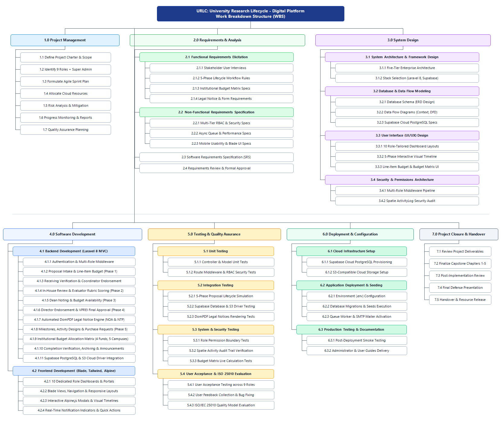

```mermaid
graph TD
  ROOT["URLC Digital Platform (WBS)"]

  %% 1.0 Project Management
  ROOT --> WBS1["1.0 Project Management"]
  WBS1 --> T11["1.1 Define Project Charter & Scope"]
  WBS1 --> T12["1.2 Identify 9 Roles + Super Admin"]
  WBS1 --> T13["1.3 Formulate Agile Sprint Plan"]
  WBS1 --> T14["1.4 Allocate Cloud Resources"]
  WBS1 --> T15["1.5 Risk Analysis & Mitigation"]
  WBS1 --> T16["1.6 Progress Monitoring & Reports"]
  WBS1 --> T17["1.7 Quality Assurance Planning"]

  %% 2.0 Requirements & Analysis
  ROOT --> WBS2["2.0 Requirements & Analysis"]
  WBS2 --> G21["2.1 Functional Requirements Elicitation"]
  G21 --> T211["2.1.1 Stakeholder User Interviews"]
  G21 --> T212["2.1.2 5-Phase Lifecycle Workflow Rules"]
  G21 --> T213["2.1.3 Institutional Budget Matrix Specs"]
  G21 --> T214["2.1.4 Legal Notice & Form Requirements"]
  WBS2 --> G22["2.2 Non-Functional Requirements Specification"]
  G22 --> T221["2.2.1 Multi-Tier RBAC & Security Specs"]
  G22 --> T222["2.2.2 Async Queue & Performance Specs"]
  G22 --> T223["2.2.3 Mobile Usability & Blade UI Specs"]
  WBS2 --> T23["2.3 Software Requirements Specification (SRS)"]
  WBS2 --> T24["2.4 Requirements Review & Formal Approval"]

  %% 3.0 System Design
  ROOT --> WBS3["3.0 System Design"]
  WBS3 --> G31["3.1 System Architecture & Framework Design"]
  G31 --> T311["3.1.1 Five-Tier Enterprise Architecture"]
  G31 --> T312["3.1.2 Stack Selection (Laravel 8, Supabase)"]
  WBS3 --> G32["3.2 Database & Data Flow Modeling"]
  G32 --> T321["3.2.1 Database Schema (ERD Design)"]
  G32 --> T322["3.2.2 Data Flow Diagrams (Context, DFD)"]
  G32 --> T323["3.2.3 Supabase Cloud PostgreSQL Specs"]
  WBS3 --> G33["3.3 User Interface (UI/UX) Design"]
  G33 --> T331["3.3.1 10 Role-Tailored Dashboard Layouts"]
  G33 --> T332["3.3.2 5-Phase Interactive Visual Timeline"]
  G33 --> T333["3.3.3 Line-Item Budget & Budget Matrix UI"]
  WBS3 --> G34["3.4 Security & Permissions Architecture"]
  G34 --> T341["3.4.1 Multi-Role Middleware Pipeline"]
  G34 --> T342["3.4.2 Spatie ActivityLog Security Audit"]

  %% 4.0 Software Development
  ROOT --> WBS4["4.0 Software Development"]
  WBS4 --> G41["4.1 Backend Development (Laravel 8 MVC)"]
  G41 --> T411["4.1.1 Authentication & Multi-Role Middleware"]
  G41 --> T412["4.1.2 Proposal Intake & Line-Item Budget (Phase 1)"]
  G41 --> T413["4.1.3 Receiving Verification & Coordinator Endorsement"]
  G41 --> T414["4.1.4 In-House Review & Evaluator Rubric Scoring (Phase 2)"]
  G41 --> T415["4.1.5 Dean Noting & Budget Availability Certification (Phase 3)"]
  G41 --> T416["4.1.6 Director Endorsement & VPREI Final Approval (Phase 4)"]
  G41 --> T417["4.1.7 Automated DomPDF Legal Notice Engine (NOA & NTP)"]
  G41 --> T418["4.1.8 Milestones, Activity Designs & Purchase Requests (Phase 5)"]
  G41 --> T419["4.1.9 Institutional Budget Allocation Matrix (4 Funds, 5 Campuses)"]
  G41 --> T4110["4.1.10 Completion Verification, Archiving & Announcements"]
  G41 --> T4111["4.1.11 Supabase PostgreSQL & S3 Cloud Driver Integration"]
  WBS4 --> G42["4.2 Frontend Development (Blade, Tailwind, Alpine)"]
  G42 --> T421["4.2.1 10 Dedicated Role Dashboards & Portals"]
  G42 --> T422["4.2.2 Blade Views, Navigation & Responsive Layouts"]
  G42 --> T423["4.2.3 Interactive Alpine.js Modals & Visual Timelines"]
  G42 --> T424["4.2.4 Real-Time Notification Indicators & Quick Actions"]

  %% 5.0 Testing & Quality Assurance
  ROOT --> WBS5["5.0 Testing & Quality Assurance"]
  WBS5 --> G51["5.1 Unit Testing"]
  G51 --> T511["5.1.1 Controller & Model Unit Tests"]
  G51 --> T512["5.1.2 Route Middleware & RBAC Security Tests"]
  WBS5 --> G52["5.2 Integration Testing"]
  G52 --> T521["5.2.1 5-Phase Proposal Lifecycle Simulation"]
  G52 --> T522["5.2.2 Supabase Database & S3 Driver Testing"]
  G52 --> T523["5.2.3 DomPDF Legal Notices Rendering Tests"]
  WBS5 --> G53["5.3 System & Security Testing"]
  G53 --> T531["5.3.1 Role Permission Boundary Tests"]
  G53 --> T532["5.3.2 Spatie Activity Audit Trail Verification"]
  G53 --> T533["5.3.3 Budget Matrix Live Calculation Tests"]
  WBS5 --> G54["5.4 User Acceptance & ISO 25010 Evaluation"]
  G54 --> T541["5.4.1 User Acceptance Testing across 9 Roles"]
  G54 --> T542["5.4.2 User Feedback Collection & Bug Fixing"]
  G54 --> T543["5.4.3 ISO/IEC 25010 Quality Model Evaluation"]

  %% 6.0 Deployment & Configuration
  ROOT --> WBS6["6.0 Deployment & Configuration"]
  WBS6 --> G61["6.1 Cloud Infrastructure Setup"]
  G61 --> T611["6.1.1 Supabase Cloud PostgreSQL Provisioning"]
  G61 --> T612["6.1.2 S3-Compatible Cloud Storage Setup"]
  WBS6 --> G62["6.2 Application Deployment & Seeding"]
  G62 --> T621["6.2.1 Environment (.env) Configuration"]
  G62 --> T622["6.2.2 Database Migrations & Seeds Execution"]
  G62 --> T623["6.2.3 Queue Worker & SMTP Mailer Activation"]
  WBS6 --> G63["6.3 Production Testing & Documentation"]
  G63 --> T631["6.3.1 Post-Deployment Smoke Testing"]
  G63 --> T632["6.3.2 Administrator & User Guides Delivery"]

  %% 7.0 Project Closure & Handover
  ROOT --> WBS7["7.0 Project Closure & Handover"]
  WBS7 --> T71["7.1 Review Project Deliverables"]
  WBS7 --> T72["7.2 Finalize Capstone Chapters 1-5"]
  WBS7 --> T73["7.3 Post-Implementation Review"]
  WBS7 --> T74["7.4 Final Defense Presentation"]
  WBS7 --> T75["7.5 Handover & Resource Release"]
```

# Chapter 3 – Work Breakdown Structure (WBS)
**University Research Lifecycle – Digital Platform (URLC System)**
*Section: Schedule Feasibility – Work Breakdown Structure (Figure 28 / Figure 25 Revision)*

> [!IMPORTANT]
> **Summary of WBS Revisions (Letter-Size Paper Optimization):**
> 1. **Letter-Size Paper Friendly Layout:** The WBS diagram has been restructured from a wide horizontal layout into an optimized **two-tier balanced hierarchy** (1660 × 1410 px, ~1.18:1 aspect ratio). When inserted into a standard 8.5" × 11" Letter paper in Microsoft Word / Google Docs (with standard 1-inch margins = 6.5" printable width), it renders at **6.5" wide × 5.52" tall**. This allows the diagram to comfortably fit on a single portrait page alongside the section headings, introductory text, and figure caption, with much larger, crisp, and readable text labels.
> 2. **Complete 9 Roles + Super Admin Scope:** Explicitly incorporates all 9 institutional roles (Faculty Researcher, College Coordinator, College Dean, Support Staff Receiving, Support Staff Recording, Technical Reviewer, Budget Officer, Research Director, VPREI) plus the Super Admin across all work packages.
> 3. **5-Phase Research Lifecycle Integration:**
>    - **Phase 1:** Submission, Line-Item Budget (LIB: PS, MOOE, CO), and College Coordinator/Dean screening.
>    - **Phase 2:** Central receiving verification, In-House Review acceptance, and standardized Technical Evaluator scoring rubrics.
>    - **Phase 3:** College Dean final copy noting and Budget Officer fund availability certification across institutional fund sources.
>    - **Phase 4:** Research Director endorsement to VPREI, Executive Final Approval, and automated **DomPDF** generation of official **Notice of Acceptance (NOA)** and **Notice to Proceed (NTP)** PDFs.
>    - **Phase 5:** Implementation milestones, activity designs, purchase requests (PR), terminal reports, completion certificates, and public cloud repository archiving.
> 4. **Institutional Budget Allocation Matrix:** Dedicated work packages under Requirements, System Design, and Backend/Frontend Development for the multi-campus two-tier budget matrix across 4 fund types (*GAA*, *Local Trust Fund*, *Foreign Trust Fund*, *Implementation Trust Fund*) covering Main Campus (75 active program units) and 4 external campuses (*Libertad*, *Caluya*, *Hamtic*, *Tibiao*), including print-ready sheet export.
> 5. **Comprehensive WBS Dictionary for Chapter 3:** Provided ready-to-insert academic text for Microsoft Word / Google Docs detailing WBS levels 1.0 through 7.0.

---

## High-Resolution Work Breakdown Structure Diagram (Letter-Size Optimized)

*High-resolution PNG file saved in project workspace at [`docs/work_breakdown_structure/wbs_urlc_system.png`](file:///c:/Users/andre/urlc-system/docs/work_breakdown_structure/wbs_urlc_system.png).*

---

## Academic Narrative & WBS Dictionary for Chapter 3

*(Copy-paste directly into your Capstone manuscript under **Schedule Feasibility > Work Breakdown Structure**)*

### Work Breakdown Structure (WBS)

The Work Breakdown Structure (WBS) decomposes the development and implementation of the **University Research Lifecycle – Digital Platform (URLC System)** into manageable, hierarchically structured work packages. Following the Agile Software Development Life Cycle (SDLC) methodology outlined in this chapter, the project is structured into seven primary Level-1 deliverables organized into two interconnected phases: **Phase I (Planning, Requirements Engineering & System Design)** and **Phase II (Software Development, Quality Assurance, Cloud Deployment & Handover)**.

**Figure 28. Work Breakdown Structure of the University Research Lifecycle – Digital Platform**  
*(Note: Corresponds to Figure 25 if utilizing pre-activity diagram numbering).*

The WBS ensures comprehensive traceability between the system objectives established in Chapter 1 and the technical implementations realized across the platform’s nine institutional roles and five-phase lifecycle. The detailed scope of each work package is defined in the WBS Dictionary below:

#### 1.0 Project Management
The Project Management work package encompasses the administrative governance, planning, resource allocation, and risk management required to successfully execute the capstone project.
* **1.1 Define Project Charter & Scope:** Establishes the project boundaries, institutional justification, core objectives, and formal approval parameters with the University of Antique Research Unit.
* **1.2 Identify 9 Roles + Super Admin:** Maps the institutional hierarchy and responsibilities of the nine specialized user roles (Faculty Researchers, College Coordinators, College Deans, Support Staff Receiving, Support Staff Recording, Technical Reviewers/Evaluators, Budget Officers, Research Director/Admin, and VPREI) alongside the pre-seeded Super Admin.
* **1.3 Formulate Agile Sprint Plan:** Structures the project timeline into iterative two-week development sprints focusing on modular deliverable delivery.
* **1.4 Allocate Cloud Resources:** Provisions developer workstations, local development servers, GitHub version control repositories, and Supabase cloud resources.
* **1.5 Risk Analysis & Mitigation:** Identifies technical, organizational, and schedule risks—including data privacy considerations, cloud API limits, and user adoption barriers—and defines proactive mitigation strategies.
* **1.6 Progress Monitoring & Reports:** Establishes weekly team reviews, sprint retrospectives, and academic documentation milestones.
* **1.7 Quality Assurance Planning:** Formulates the testing framework aligned with the ISO/IEC 25010 software product quality standard.

#### 2.0 Requirements Engineering & Analysis
This phase captures the operational needs of university research stakeholders and translates them into structured software engineering specifications.
* **2.1 Functional Requirements Elicitation:**
  * *2.1.1 Stakeholder User Interviews:* Conducts structured interviews with university researchers, college coordinators, deans, budget personnel, research administrators, and the VPREI to capture domain pain points.
  * *2.1.2 5-Phase Lifecycle Workflow Rules:* Formalizes the state transitions, conditional gating criteria, revision resubmission loops, and approval thresholds governing the university research lifecycle.
  * *2.1.3 Institutional Budget Matrix Specs:* Gathers specifications for the two-tier institutional fund matrix (GAA, Local Trust Fund, Foreign Trust Fund, Implementation Trust Fund) across the Main Campus (75 active program units) and four satellite campuses (Libertad, Caluya, Hamtic, Tibiao).
  * *2.1.4 Legal Notice & Form Requirements:* Defines the formatting standards and data fields required for the dynamic generation of official institutional instruments (Notice of Acceptance, Notice to Proceed, Certificate of Research Completion).
* **2.2 Non-Functional Requirements Specification:**
  * *2.2.1 Multi-Tier RBAC & Security Specs:* Specifies encryption standards (Bcrypt), session management, Cross-Site Request Forgery (CSRF) defense, and granular role permissions.
  * *2.2.2 Async Queue & Performance Specs:* Establishes sub-two-second page rendering benchmarks and defines asynchronous queue workers for transactional email notifications.
  * *2.2.3 Mobile Usability & Blade UI Specs:* Outlines responsive viewport criteria across desktop, laptop, tablet, and mobile browsers.
* **2.3 Software Requirements Specification (SRS):** Compiles functional models, data dictionaries, and non-functional specifications into a formal IEEE-compliant SRS document.
* **2.4 Requirements Review & Formal Approval:** Validates the SRS with capstone advisers and Research Unit stakeholders for technical baseline sign-off.

#### 3.0 System Architecture & Design
Translates the requirements specification into technical blueprints, database schemas, and user experience wireframes.
* **3.1 System Architecture & Framework Design:**
  * *3.1.1 Five-Tier Enterprise Architecture:* Designs the decoupled five-tier system model comprising the User Tier, Laravel Security Gate/Middleware Tier, Blade/Tailwind Presentation Tier, Laravel MVC Application Tier, and Supabase Cloud Infrastructure Tier.
  * *3.1.2 Stack Selection:* Finalizes the technology stack: PHP 8, Laravel Framework 8.x, Supabase Cloud PostgreSQL, Supabase S3-Compatible Cloud Storage, and DomPDF.
* **3.2 Database & Data Flow Modeling:**
  * *3.2.1 Database Schema (ERD Design):* Normalizes relational database tables (`users`, `user_roles`, `research_proposals`, `proposal_budget_items`, `proposal_revisions`, `proposal_reviews`, `proposal_milestones`, `announcements`, `system_settings`, `activity_log`).
  * *3.2.2 Data Flow Diagrams (Context & DFDs):* Maps the Context Diagram (Level 0) and detailed Level 1/Level 2 functional data transformations across processes.
  * *3.2.3 Supabase Cloud PostgreSQL Specs:* Defines foreign key constraints, cascading behaviors, indexing strategies, and JSON/array casting configurations.
* **3.3 User Interface (UI/UX) Design:**
  * *3.3.1 10 Role-Tailored Dashboard Layouts:* Wireframes distinct, customized dashboard layouts tailored to the operational scope of each stakeholder.
  * *3.3.2 5-Phase Interactive Visual Timeline:* Designs visual progress trackers and step indicators displaying real-time proposal statuses.
  * *3.3.3 Line-Item Budget & Budget Matrix UI:* Wireframes interactive tabular editors for encoding proposal expenditures (PS, MOOE, CO) and multi-campus budget matrix allocations.
* **3.4 Security & Permissions Architecture:**
  * *3.4.1 Multi-Role Middleware Pipeline:* Architects custom middleware (`RoleMiddleware`, `ApprovalMiddleware`, `PreventBackHistory`) to enforce least-privilege route protection.
  * *3.4.2 Spatie ActivityLog Security Audit:* Designs the event-driven immutable audit trail logging user identities, IP addresses, and state changes.

#### 4.0 Software Development & Implementation
Constructs the platform’s business logic, user interfaces, database persistence layer, and external service integrations.
* **4.1 Backend Development (Laravel 8 MVC):**
  * *4.1.1 Authentication & Multi-Role Middleware:* Implements Bcrypt authentication, account approval verification, session-based multi-role switching, and middleware guards.
  * *4.1.2 Proposal Intake & Line-Item Budget (Phase 1):* Develops controllers and Eloquent models for creating proposals, uploading PDF manuscripts, and itemizing dynamic Line-Item Budgets.
  * *4.1.3 Receiving Verification & Coordinator Endorsement:* Implements departmental screening routes for College Coordinators and centralized intake checks for Support Staff (Receiving).
  * *4.1.4 In-House Review & Evaluator Rubric Scoring (Phase 2):* Implements reviewer assignment logic, quantitative rubric scoring, qualitative comment threads, and revision resubmission tracking.
  * *4.1.5 Dean Noting & Budget Availability Certification (Phase 3):* Implements post-review final copy noting by College Deans and financial audit/certification by Budget Officers.
  * *4.1.6 Director Endorsement & VPREI Final Approval (Phase 4):* Implements executive endorsement routing by the Research Director and final executive approval/rejection by the VPREI.
  * *4.1.7 Automated DomPDF Legal Notice Engine:* Develops server-side PDF compilation rendering standardized, publication-grade Notice of Acceptance (NOA) and Notice to Proceed (NTP) documents.
  * *4.1.8 Milestones, Activity Designs & Purchase Requests (Phase 5):* Builds progress milestone tracking, activity design workflows, and itemized purchase request (PR) approvals.
  * *4.1.9 Institutional Budget Allocation Matrix:* Develops the two-tier matrix controller calculating GAA, Local Trust Fund, Foreign Trust Fund, and Implementation Trust Fund allocations across all 75 academic units and satellite campuses, with print-ready sheet generation.
  * *4.1.10 Completion Verification, Archiving & Announcements:* Builds completion certificate generation, public repository search and filtering, and announcement modules with comment interactions.
  * *4.1.11 Supabase PostgreSQL & S3 Cloud Driver Integration:* Integrates the Flysystem S3 cloud storage driver for secure, time-signed document access and configures Eloquent database connections.
* **4.2 Frontend Development (Blade, Tailwind, Alpine):**
  * *4.2.1 10 Dedicated Role Dashboards & Portals:* Constructs Blade view templates rendering tailored interfaces and actionable proposal queues for all system roles.
  * *4.2.2 Blade Views, Navigation & Responsive Layouts:* Develops cohesive navigation bars, sidebar menus, breadcrumbs, and card layouts styled with Tailwind CSS and Bootstrap.
  * *4.2.3 Interactive Alpine.js Modals & Visual Timelines:* Implements client-side modal dialogs for rubric scoring, revision uploads, and interactive phase progression badges.
  * *4.2.4 Real-Time Notification Indicators & Quick Actions:* Builds alert banners, toast notifications, and quick-action shortcuts for pending tasks.

#### 5.0 Testing & Quality Assurance
Subjecting the platform to multi-tier verification and formal empirical software quality evaluation.
* **5.1 Unit Testing:**
  * *5.1.1 Controller & Model Unit Tests:* Tests Eloquent relationships, budget total calculations, and controller business logic.
  * *5.1.2 Route Middleware & RBAC Security Tests:* Verifies that unauthenticated or unauthorized users are strictly blocked with 403 Forbidden responses.
* **5.2 Integration Testing:**
  * *5.2.1 5-Phase Proposal Lifecycle Simulation:* Executes end-to-end simulated submissions flowing sequentially through all nine roles and five phases.
  * *5.2.2 Supabase Database & S3 Driver Testing:* Validates cloud upload speeds, file integrity, and secure URL expiration.
  * *5.2.3 DomPDF Legal Notices Rendering Tests:* Validates PDF layout formatting, header alignment, dynamic signature binding, and cross-platform readability.
* **5.3 System & Security Testing:**
  * *5.3.1 Role Permission Boundary Tests:* Tests privilege escalation prevention and ensures users cannot tamper with unauthorized proposal actions.
  * *5.3.2 Spatie Activity Audit Trail Verification:* Confirms that all critical actions (approvals, reviews, deletions, logins) are immutably logged with timestamps and actor IDs.
  * *5.3.3 Budget Matrix Live Calculation Tests:* Verifies arithmetic accuracy across program subtotals and institutional grand totals in the budget allocation matrix.
* **5.4 User Acceptance & ISO 25010 Evaluation:**
  * *5.4.1 User Acceptance Testing across 9 Roles:* Conducts hands-on UAT sessions with actual university faculty, coordinators, deans, reviewers, budget personnel, and administrators.
  * *5.4.2 User Feedback Collection & Bug Fixing:* Resolves identified UI friction points, database query optimizations, and validation enhancements.
  * *5.4.3 ISO/IEC 25010 Quality Model Evaluation:* Administers a standardized Likert-scale instrument to a purposive sample of not less than 30 stakeholders, evaluating the system across all eight quality characteristics (Functional Suitability, Reliability, Usability, Performance Efficiency, Maintainability, Portability, Security, and Compatibility).

#### 6.0 Deployment & Configuration
Prepares and executes the production release of the URLC platform in a secure cloud environment.
* **6.1 Cloud Infrastructure Setup:**
  * *6.1.1 Supabase Cloud PostgreSQL Provisioning:* Provisions the production PostgreSQL instance and establishes secure connection pooling.
  * *6.1.2 S3-Compatible Cloud Storage Setup:* Configures storage buckets, CORS rules, and bucket privacy policies for manuscript and certificate storage.
* **6.2 Application Deployment & Seeding:**
  * *6.2.1 Environment (.env) Configuration:* Configures production application keys, database URLs, storage credentials, and SMTP mailer parameters.
  * *6.2.2 Database Migrations & Seeds Execution:* Runs database migrations and seeds initial reference data, including the default Super Admin and the 75 academic program units.
  * *6.2.3 Queue Worker & SMTP Mailer Activation:* Configures background queue daemons to handle asynchronous email dispatches reliably.
* **6.3 Production Testing & Documentation:**
  * *6.3.1 Post-Deployment Smoke Testing:* Verifies live URL routing, SSL certificates, email delivery, and cloud file uploading in the production environment.
  * *6.3.2 Administrator & User Guides Delivery:* Authors comprehensive user manuals and administrator technical guides illustrating system operations for each role.

#### 7.0 Project Closure & Handover
Concludes the academic capstone project and formalizes institutional system handover.
* **7.1 Review Project Deliverables:** Audits all software deliverables, database schemas, and source code against the initial project charter and specific objectives.
* **7.2 Finalize Capstone Chapters 1–5:** Completes the comprehensive manuscript, integrating evaluation statistics, discussion of results, and formal recommendations.
* **7.3 Post-Implementation Review:** Documents development retrospectives, technical challenges encountered, and areas for future system expansion.
* **7.4 Final Defense Presentation:** Presents the completed URLC platform and research findings before the College of Computing and Information Sciences Capstone Evaluation Committee.
* **7.5 Handover & Resource Release:** Officially delivers the production codebase, administrative credentials, and technical documentation to the University of Antique Research Unit and releases development resources.

---

## PlantUML & Mermaid Source Code for Work Breakdown Structure

```plantuml
@startwbs WBS_URLC_System
skinparam monochrome false
skinparam roundcorner 6
skinparam shadowing false
skinparam ArrowColor #475569

<style>
wbsDiagram {
  LineColor #475569
  LineThickness 1.5
  BackgroundColor #FFFFFF
  BorderColor #94A3B8
  FontName Segoe UI
  FontSize 11
  FontColor #0F172A
  
  :depth(0) {
    BackgroundColor #1E3A8A
    FontColor #FFFFFF
    BorderColor #1E40AF
    FontSize 13
    FontStyle bold
  }
  :depth(1) {
    FontStyle bold
    FontSize 12
    BorderThickness 1.5
  }
  :depth(2) {
    FontStyle bold
    FontSize 11.5
  }
}
</style>

* **URLC: University Research Lifecycle - Digital Platform**\n**Work Breakdown Structure (WBS)**
** 1.0 Project Management
*** 1.1 Define Project Charter & Scope
*** 1.2 Identify 9 Roles + Super Admin
*** 1.3 Formulate Agile Sprint Plan
*** 1.4 Allocate Cloud Resources
*** 1.5 Risk Analysis & Mitigation
*** 1.6 Progress Monitoring & Reports
*** 1.7 Quality Assurance Planning

** 2.0 Requirements & Analysis
*** 2.1 Functional Requirements Elicitation
**** 2.1.1 Stakeholder User Interviews
**** 2.1.2 5-Phase Lifecycle Workflow Rules
**** 2.1.3 Institutional Budget Matrix Specs
**** 2.1.4 Legal Notice & Form Requirements
*** 2.2 Non-Functional Requirements Specification
**** 2.2.1 Multi-Tier RBAC & Security Specs
**** 2.2.2 Async Queue & Performance Specs
**** 2.2.3 Mobile Usability & Blade UI Specs
*** 2.3 Software Requirements Specification (SRS)
*** 2.4 Requirements Review & Formal Approval

** 3.0 System Design
*** 3.1 System Architecture & Framework Design
**** 3.1.1 Five-Tier Enterprise Architecture
**** 3.1.2 Stack Selection (Laravel 8, Supabase)
*** 3.2 Database & Data Flow Modeling
**** 3.2.1 Database Schema (ERD Design)
**** 3.2.2 Data Flow Diagrams (Context, DFD)
**** 3.2.3 Supabase Cloud PostgreSQL Specs
*** 3.3 User Interface (UI/UX) Design
**** 3.3.1 10 Role-Tailored Dashboard Layouts
**** 3.3.2 5-Phase Interactive Visual Timeline
**** 3.3.3 Line-Item Budget & Budget Matrix UI
*** 3.4 Security & Permissions Architecture
**** 3.4.1 Multi-Role Middleware Pipeline
**** 3.4.2 Spatie ActivityLog Security Audit

** 4.0 Software Development
*** 4.1 Backend Development (Laravel 8 MVC)
**** 4.1.1 Authentication & Multi-Role Middleware
**** 4.1.2 Proposal Intake & Line-Item Budget (Phase 1)
**** 4.1.3 Receiving Verification & Coordinator Endorsement
**** 4.1.4 In-House Review & Evaluator Rubric Scoring (Phase 2)
**** 4.1.5 Dean Noting & Budget Availability Certification (Phase 3)
**** 4.1.6 Director Endorsement & VPREI Final Approval (Phase 4)
**** 4.1.7 Automated DomPDF Legal Notice Engine (NOA & NTP)
**** 4.1.8 Milestones, Activity Designs & Purchase Requests (Phase 5)
**** 4.1.9 Institutional Budget Allocation Matrix (4 Funds, 5 Campuses)
**** 4.1.10 Completion Verification, Archiving & Announcements
**** 4.1.11 Supabase PostgreSQL & S3 Cloud Driver Integration
*** 4.2 Frontend Development (Blade, Tailwind, Alpine)
**** 4.2.1 10 Dedicated Role Dashboards & Portals
**** 4.2.2 Blade Views, Navigation & Responsive Layouts
**** 4.2.3 Interactive Alpine.js Modals & Visual Timelines
**** 4.2.4 Real-Time Notification Indicators & Quick Actions

** 5.0 Testing & Quality Assurance
*** 5.1 Unit Testing
**** 5.1.1 Controller & Model Unit Tests
**** 5.1.2 Route Middleware & RBAC Security Tests
*** 5.2 Integration Testing
**** 5.2.1 5-Phase Proposal Lifecycle Simulation
**** 5.2.2 Supabase Database & S3 Driver Testing
**** 5.2.3 DomPDF Legal Notices Rendering Tests
*** 5.3 System & Security Testing
**** 5.3.1 Role Permission Boundary Tests
**** 5.3.2 Spatie Activity Audit Trail Verification
**** 5.3.3 Budget Matrix Live Calculation Tests
*** 5.4 User Acceptance & ISO 25010 Evaluation
**** 5.4.1 User Acceptance Testing across 9 Roles
**** 5.4.2 User Feedback Collection & Bug Fixing
**** 5.4.3 ISO/IEC 25010 Quality Model Evaluation

** 6.0 Deployment & Configuration
*** 6.1 Cloud Infrastructure Setup
**** 6.1.1 Supabase Cloud PostgreSQL Provisioning
**** 6.1.2 S3-Compatible Cloud Storage Setup
*** 6.2 Application Deployment & Seeding
**** 6.2.1 Environment (.env) Configuration
**** 6.2.2 Database Migrations & Seeds Execution
**** 6.2.3 Queue Worker & SMTP Mailer Activation
*** 6.3 Production Testing & Documentation
**** 6.3.1 Post-Deployment Smoke Testing
**** 6.3.2 Administrator & User Guides Delivery

** 7.0 Project Closure & Handover
*** 7.1 Review Project Deliverables
*** 7.2 Finalize Capstone Chapters 1-5
*** 7.3 Post-Implementation Review
*** 7.4 Final Defense Presentation
*** 7.5 Handover & Resource Release
@endwbs
```

<strong>PlantUML Source Code (WBS Tree Format)</strong>

<strong>Mermaid Source Code (Mindmap / Flowchart Hierarchy)</strong>

